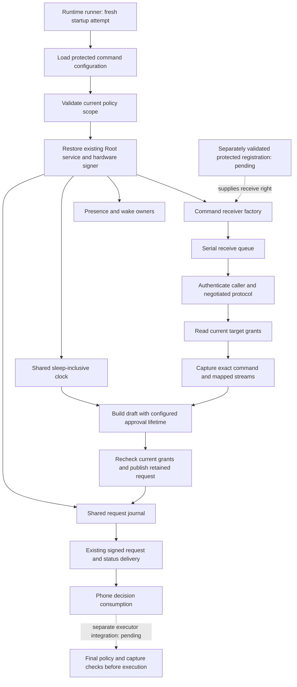

# Configured command admission runtime

The command startup record now composes with the existing Root runtime.
The factory uses one request journal, one clock and the existing presence and wake owners.
It does not create a second authority or dispatch a target.

The production factory requires real and effective Root identity before reading policy or calling the registration provider.
The installer must validate protected placement, code identity and registration independently.
Successful Mach check-in alone is insufficient.
The supplied receive right transfers to the existing host, including failure cleanup.

The factory applies the configured account, environment, size limits, session limit, waits and ancestry limit.
It advertises the implemented mapped terminal and pipe profiles.
It creates fresh stream bindings after current grant checks.
Every admission uses the original authenticated attempt and repeats the existing capture and policy checks.

The draft retains the exact capture bytes.
Startup sizing and runtime drafts use the same execute/decline action list.
It permits biometric execution and decision-key decline for the current request.
The coordinator supplies request IDs and challenges.
The shared continuous clock defines the deadline; Unix times support signed display metadata.
Both additions reject overflow.
The approval lifetime does not limit command runtime.

The runtime runner reloads protected configuration on each startup attempt.
It restores the existing signer and stores, then starts the shared service.
Failed command startup has no request-only fallback.
Existing retirement and shutdown close the receiver before the shared journal.

## Validation and limits

Six focused tests cover draft content, action requirements, configured lifetime, clock overflow, historical-profile rejection and ordinary-account startup refusal.
A native fixture negotiates each supported profile and admits a mapped command.
It checks retained age, lifetime, actions, exact arguments and environment additions, fresh grants, the audit reservation and borrowed-descriptor cleanup.
It uses an anonymous receive right, software fixture keys and an ordinary-account identity seam.
The terminal profile uses redirected disposable streams. It does not prove a real controlling terminal.

The application does not select this startup mode yet.
The APIs do not install accounts, register a service or execute approved targets.
Installed IPC validation in [issue 286](https://github.com/rock3r/remozio/issues/286) and full target-group semantics in [issue 298](https://github.com/rock3r/remozio/issues/298) remain activation gates.
Hardware signer restoration, setup provisioning, real terminal behavior and phone approval need their own installed evidence.
