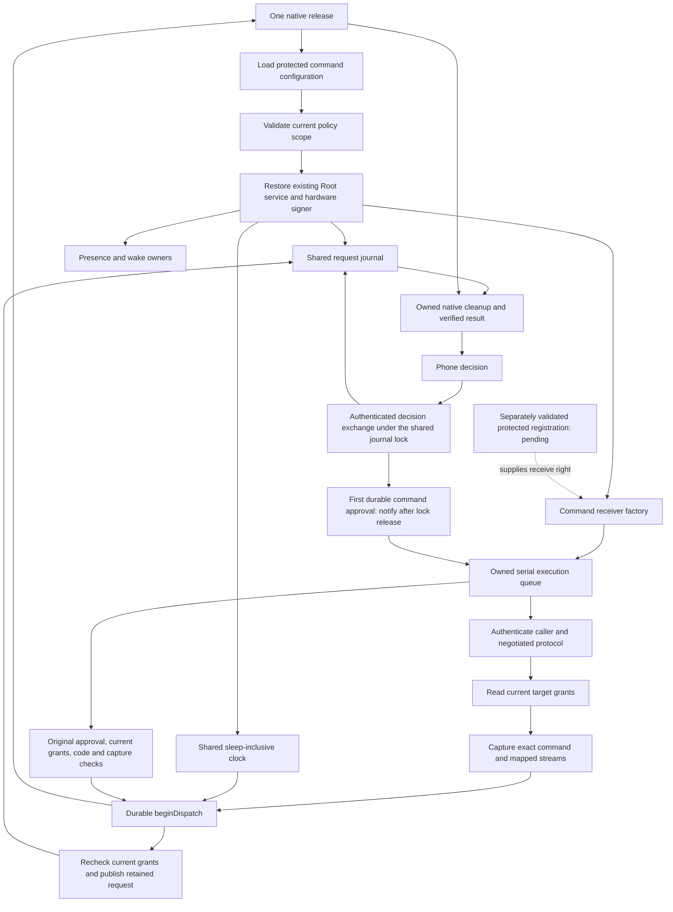

# Configured command runtime

The Root runtime uses the command startup record to configure command handling.
The factory uses one request journal, one clock and the existing presence and wake owners.
Version 2 also attaches an owned scheduler to the existing native executor.
It creates no second authority.
Installed activation still requires the remaining integration checks.

The production factory requires real and effective Root identity before reading policy or calling the registration provider.
The installer must validate protected placement, code identity and registration independently.
Successful Mach check-in alone is insufficient.
The supplied receive right transfers to the existing host, including failure cleanup.

The factory applies the configured account, environment, size limits, session limit, waits and ancestry limit.
It advertises the implemented mapped terminal and pipe profiles.
It creates fresh stream bindings after current grant checks.
Every admission uses the original authenticated attempt and repeats the existing capture and policy checks.

The draft retains the exact capture bytes.
Startup sizing and runtime drafts use the same execute/decline action list.
It permits biometric execution and decision-key decline for the current request.
The coordinator supplies request IDs and challenges.
The shared continuous clock defines the deadline; Unix times support signed display metadata.
Both additions reject overflow.
The approval lifetime does not limit command runtime.

The runtime runner reloads protected configuration on each startup attempt.
It restores the existing signer and stores, then starts the shared service.
Failed command startup has no request-only fallback.
Existing retirement and shutdown close the receiver before the shared journal.

## Validation and limits

Six focused tests cover draft content, action requirements, configured lifetime, clock overflow, historical-profile rejection and ordinary-account startup refusal.
A native fixture negotiates each supported profile and admits a mapped command.
It checks retained age, lifetime, actions, exact arguments and environment additions, fresh grants, the audit reservation and borrowed-descriptor cleanup.
It uses an anonymous receive right, software fixture keys and an ordinary-account identity seam.
The terminal profile uses redirected disposable streams. It does not prove a real controlling terminal.

The embedded authority now selects this runtime through the [installed command host](macos-installed-command-entrypoint.md).
Protected setup and actual installed activation remain pending.
The APIs do not install accounts or register a service.
Configured version 2 execution still requires the installed activation gates below.
Installed IPC validation in [issue 286](https://github.com/rock3r/remozio/issues/286) and full target-group semantics in [issue 298](https://github.com/rock3r/remozio/issues/298) remain activation gates.
Hardware signer restoration, setup provisioning, real terminal behavior and phone approval need their own installed evidence.

## Command authorization notifications

The configured runtime can supply a trusted scheduling callback.
The transport, listener, request service and wake owner pass it through one exchange path.
Legacy and request-only hosts may use a no-op observer callback.
Version 2 always queues the notice with its owned scheduler before calling that observer.

The exchange validates current transport policy and phone enrollment under the shared journal lock.
Only a first queued or presented command transition to authorized produces a notice.
The notice binds the retained request ID, digest and challenge to accepted durable consumption.
It runs after the journal lock is released, even when status signing fails after consumption.
Status queries, repeated decisions, declines, expiry and rejected decisions produce no new notice.
1Password and Little Snitch decisions never notify the command executor.

The callback must enqueue promptly.
The notice grants no permission to execute.
The executor must recheck current enrollment, policy, original capture, caller, deadline and streams before release.
It must reject duplicate release and never replay uncertain execution after restart.
Version 2 now constructs the scheduler and uses the existing native execution owner. Installed activation remains pending.

Seven focused tests cover native command consumption, cross-thread journal access after notification, actual signed exchange, signer failure and access gates.
The non-command tests include 1Password access and unlock, persistent Little Snitch rules, and allow-once with the decision key.
These fixtures use an ordinary account and software keys.
They do not start installed IPC, execute targets or operate either application's UI.

## Configured execution owner

Version 2 requires a versioned execution record with monitor and child paths, a preparation bound, a file creation mask, and resource limits.
The preparation bound applies before target release. It does not impose a command runtime limit.
Version 1 retains its exact bytes and admission-only behavior. Missing or unknown version 2 fields fail; startup never falls back to version 1.

The scheduler shares the request journal and clock. It starts before request listeners and reports its failure to the enclosing runtime.
Shutdown stops new decision exchanges and joins their post-lock authorization callbacks before draining the execution worker.
It prevents further attempts and joins queued work before closing the journal. Native resource disposal remains with the existing execution owner.
Each runtime retry builds a fresh scheduler. It never scans historical approvals to repeat a command.

A scheduling notice is not an execution grant. The scheduler checks its original request ID, digest and challenge.
The existing executor then rechecks enrollment, code generations, current grants, retained descriptors, content, caller identity and deadline.
It commits dispatch before a single native release. Status delivery, reconnect and duplicate notices cannot repeat that release.

A thrown start can already own a monitor. The rejection operation first proves that this journal holds no native execution owner for the request.
It cancels only the exact original authorized request. It commits the no-dispatch result and sends the original frontend its terminal reply.
A native owner keeps its resources, cleanup and actual outcome. An exception is never treated as proof that no child exists.

A notice refused during saturation or shutdown receives the same exact-request rejection before enqueue returns.
Shutdown joins in-flight rejection work. A rejection storage failure retires the runtime and reports failure without claiming cancellation.
Saturation retires the enclosing runtime after rejection instead of silently dropping an approval.
The execution queue and active command limits remain explicit host settings. Installed Root behavior and complete target groups remain gates in issues 286 and 298.
The embedded entry point can select command mode after protected installation checks. The installer remains pending.

Twenty-three focused checks cover the scheduler, versioned configuration, original-request rejection, native ownership and enclosing runtime lifecycle.
The native cases execute disposable ordinary-account targets through both current mapped profiles.
They preserve one effect after a handler failure and a duplicate notice. They also retain a monitor after a failed start attempt.
Late-callback fixtures cover both explicit shutdown and deinitialization with a real signed approval and original frontend reply.
A frozen public-only version 1 fixture checks exact byte compatibility. These results do not prove installed Root execution or complete target-group semantics.
