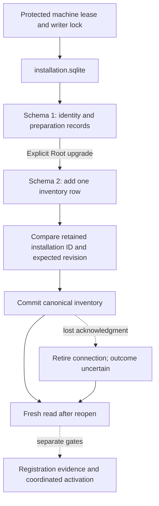

# Durable installation inventory

Preparation records and inventory share `installation.sqlite`, one retained lease and one exclusive machine writer lock.
They use the same transaction owner and storage retirement rules.
A shared writer prevents races between preparation and inventory writes.
Account request journals remain separate.

## Explicit storage transition

Opening or initializing a preparation store retains schema 1 behavior.
`enableInventoryStorage` explicitly creates the inventory table and commits storage version 2 in one transaction.
It validates existing preparation records first and preserves their IDs, revisions and contents.
An existing version 2 store needs no repeated initialization.
The manifest declares both preparation formats and the 1-to-2 migration.

The upgrade is a storage operation, not permission to activate a release.
A future update owner must schedule it with compatibility and the approved replacement boundary.
An old reader that supports only schema 1 cannot read schema 2.
The current app does not select or perform this migration.

## Revision and scope checks

The inventory table has one bounded canonical record.
`initializeInventory` refuses an existing row.
`replaceInventory` requires the retained revision, the same installation ID and the same Mac ID.
The store generates a fresh random UUID revision for each write and returns the retained record.
It never uses the caller-proposed revision, so a caller cannot revive a stale token by restoring an older value.
A missing record, stale revision or attempted identity change does not overwrite retained state.
There is no implicit reset, erase or inventory-removal API.

The reader compares row identity and revision columns with decoded record fields.
It rejects unknown versions, unexpected table identities and malformed inventory.
Corruption or changed leased file identities retire the shared connection.
Preparation access retires with it; neither path can continue through an unsafe lease.

Schema 2 permits the codec's full 65,536-byte record within a 69,632-byte SQLite row limit.
Schema 1 keeps its existing SQLite limit.
Preparation records retain their separate 16 KiB bound in both schemas.
Public inventory operations require real and effective Root identity before access or mutation.

## Commit and recovery

The existing store uses delete journaling, extra synchronous writes and full filesystem sync.
A commit failure or failure after commit retires the connection.
The caller must reopen and compare retained state before deciding what happened.
A later observed revision is current-state evidence; it does not recreate a missing acknowledgment.
The test-only post-commit hook is unavailable through public initialization.

Fifteen new tests cover migration, writer exclusion, scope, revision checks, large records, corrupt rows, Root refusal and uncertain commits.
The twenty existing preparation tests also pass.
Fixtures use ordinary-owner private directories and the internal lease seam.
They do not prove Root isolation, native I/O fault behavior or power-loss durability.

The [actual-store process experiment](experiments/installation-inventory-recovery.md) now checks writer exclusion, `_exit` and SIGKILL after commit.
The local ordinary-owner run preserved inventory and preparation records on macOS 27.0.1.
It does not establish power-loss durability or Root isolation.
The earlier separate-database prototype remains distinct from this implementation.
Installed Root loading, signed plist/configuration matching, complete owner enumeration and service continuity remain platform gates.
Inventory metadata grants no enrollment, command execution, admission freeze or update activation authority.

The [account initialization intent](macos-authority-initialization-intent.md) adds explicit storage version 3.
It retains setup progress under the same writer lock. Ordinary inventory reads do not create setup intent.
