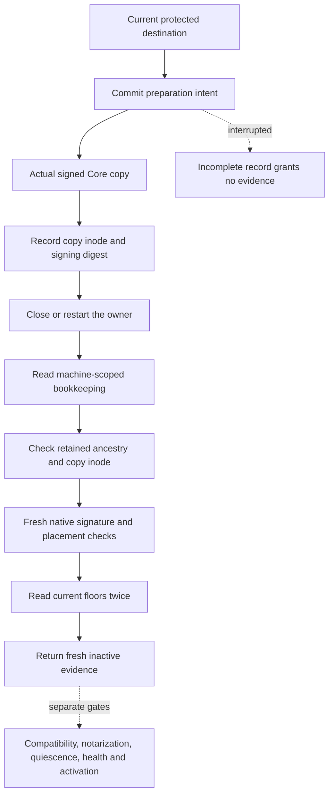

# Durable inactive release preparation

The Core component records preparation before copying and revalidates a completed copy after restart.
It grants no installation or activation authority.

## Storage boundary

`PreparationIntentStore.open` requires real and effective Root identity.
Setup must provision a separate private machine-level directory, `writer.lock` and `installation.sqlite`.
The lease retains each ancestor and file identity, checks private permissions and holds the exclusive writer lock.
It checks the process identity and both user IDs throughout its lifetime.
The storage schema is version 1. It is independent of account request and consumption journals.

SQLite uses delete journaling, extra synchronous writes and full filesystem sync.
The store fixes its application identity and Mac ID. It rejects unknown schemas and implicit reinitialization.
Rows bind their IDs and revisions to canonical bounded records.
Malformed records, native SQLite corruption or changed storage identities retire the connection.
Primary and extended `SQLITE_CORRUPT` and `SQLITE_NOTADB` results retire the store, including failures while starting a transaction.
An unsuccessful commit retires the connection; the caller must reopen and reconcile retained state.

The default capacity is 64 records, with a hard maximum of 4,096.
Reducing the configured capacity preserves existing records and blocks only new preparation.
Each canonical record permits at most 16 KiB, 64 ancestor identities and a bounded absolute destination path.
Revision checks reject stale updates. An abandoned attempt cannot return to a completed state.
Before a new preparation, reconciliation reclaims abandoned bookkeeping only when the target path and retained ancestry still match and the copy is absent.
It never removes filesystem objects. Existing copies, unknown entries, mismatched targets and changed ancestry retain their records.
The public reconciliation entry point requires Root. Successful or incomplete live records cannot be forgotten.
The hard record limit is checked before insertion, so reaching it returns capacity rather than creating an unreadable store.

## Recovery boundary

| Retained state | Recovery result |
| --- | --- |
| Intent only | Incomplete; no copy evidence |
| Completed copy record | Inspect current ancestry, inode, metadata, signature and floors |
| Abandoned attempt | No copy evidence |
| Corrupt or replaced store | Retire the connection and preserve files |

The recorded digest binds the signed manifest and each component code hash.
Stored data never constructs signature evidence by itself.
Recovery uses the native inspector again and reads current code policy before and after validation.
Changed inodes, signing metadata, copied attributes or advanced floors reject recovery.
Preparation and recovery preserve request history, pairing and consumed decisions by leaving their journals separate.

The returned bundle URLs explicitly describe directories, including before their creation.
This keeps preparation and recovery URL identity stable.

## Failure and limits

The existing copier retains its immediate owned cleanup rules.
A copy that completes before a persistence failure can remain on disk.
The error preserves the preparation and record failures when both occur.
A directory alone never grants evidence. Unknown orphan entries remain untouched.

Twenty Core tests cover recovery, fresh inspection, inode replacement, floor advancement, revisions, scope, capacity and corruption.
The internal unit inspector seam checks control flow; it does not prove native signing or Root isolation.
The guarded SDK experiment uses the actual copier and native inspector across store reopen.
It checks signing equality, advanced floors, changed metadata, restored metadata and preserved records.
All 71 focused copy and recovery tests and six native controls passed on the recorded host.

Standalone ordinary-owner prototypes also check committed intent and copy metadata across process exit without explicit close.
A fixture-only commit rejection retires its connection and preserves the prior intent.
These prototype controls are not committed Core tests or power-loss evidence.

Protected service installation, Root isolation, another-account access, power loss and unknown-orphan reconciliation remain unproven.
Compatibility, notarization, admission quiescence, startup health, floor commit and durable activation remain separate work.
The macOS 26 deployment target does not prove macOS 26 runtime behavior.

See the [native evidence](experiments/inactive-release-copy.json) and [copied metadata policy](macos-copied-release-metadata.md).
