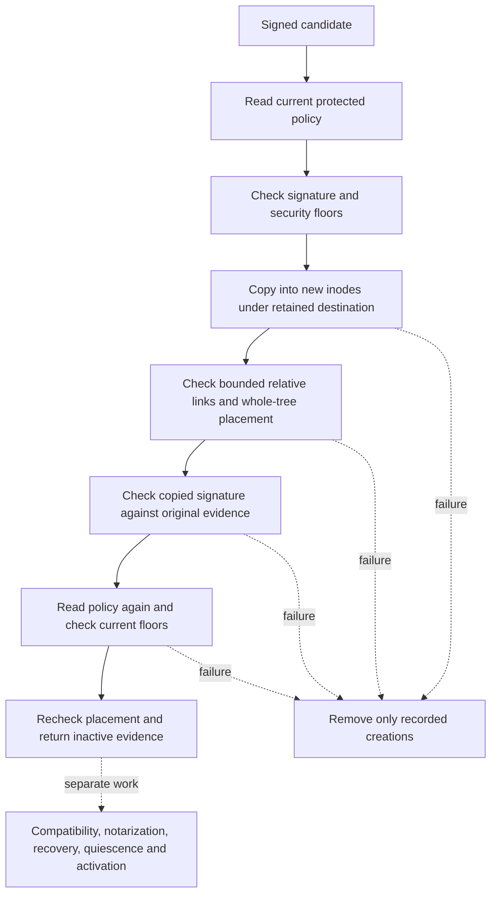

# Inactive release preparation

The Core component prepares a new inactive copy from a signed candidate.
It does not install services or replace active code.

## Production boundary

`ReleaseDestinationLease.acquire` requires real and effective Root identity.
It retains each destination ancestor from the filesystem root.
It rejects symbolic ancestors, unsafe ownership, mutation permissions, mutation ACLs and unsupported mounts.
The lease checks its process identity and each retained inode before and after preparation.
A failed lease check retires the lease.

`ProtectedReleasePreparation.prepare` also requires real and effective Root identity.
The caller supplies a reader for current protected code policy.
The retained app entry supplies the expected Team and identifier.
The candidate never supplies its own trusted identity or policy.

The internal copier and ordinary-owner constructors support component tests.
They have no public owner override or public ordinary-parent copy API.
The native experiment reaches them through test access in its guarded executable.

## Copy and validation

Creation is exclusive. Existing destinations remain untouched.
Regular files use new inodes. Hardlinks and special files are rejected.
The copy checks source descriptor and named identity before and after reading.
It strips unsafe modes and does not copy source ACLs, flags or extended attributes.
It preserves bounded relative links, then resolves each chain within the copied root.
Cycles, escaping chains and unsupported targets prevent completion.

Default hard limits are 8,192 entries, 16 directory levels and 1 GiB of file data.
Caller-selected limits can lower those bounds.
Cancellation runs between nodes, data chunks and link expansion.
The synchronous copy must run outside the app UI and authority dispatch queue.

The placement check examines every copied file, directory and link.
It checks ownership, mode, ACL, mount, link count and stable inode metadata.
It also applies the [copied metadata policy](macos-copied-release-metadata.md) through retained object descriptors.
Signature inspection then checks the complete executable inventory and enclosing seal.
The copied manifest and every role and dependency hash must match the original evidence.
A second policy read rejects a candidate that falls below newly retained floors.
A final placement check precedes the returned evidence.

## Failure and remaining work

Immediate failure cleanup removes only recorded paths with matching inode identities.
It preserves siblings, unknown entries and replacement inodes or directories.
If cleanup fails, the error retains both the original and cleanup failures.
No failed preparation returns inactive evidence.
If creation identity cannot be recorded, cleanup preserves the unknown directory and reports its failure.

The [durable preparation component](macos-durable-release-preparation.md) now records progress and revalidates completed copies after reopen.
Unknown-orphan reconciliation and activation recovery remain unimplemented.
A directory left by an interrupted operation is not activation evidence.
The caller must revalidate protected state and the copy at the installation boundary.
The returned value is a snapshot and grants no activation authority.

Data-only copying has passed the known SDK fixture.
Source resource forks and attributes are not preserved.
Releases that require them are unsupported by the copying contract.
The copied tree rejects file flags and all attributes except OS provenance.
Root ownership and another-account isolation still need platform tests.
Compatibility, notarization, quiescence, service health and durable activation remain separate gates.

See the [native experiment](experiments/inactive-release-copy.md) for measured results and limits.
