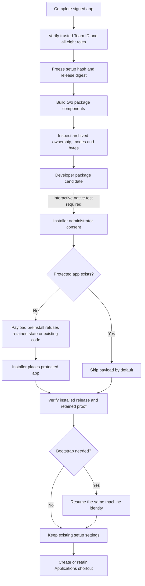

# Initial macOS package

The package builder prepares a developer candidate. It never installs the package or registers services.
All persistent executables stay inside one app.
The package requires macOS 26 or later, Apple Silicon and the current startup volume.



The payload installs at `/Library/Application Support/Remozio/Applications/Remozio.app`.
Its native preinstall script uses a temporary copy of the verified setup executable.
The package embeds that executable's hash, the release digest and the independently trusted Team ID.
The temporary helper checks its own signature before protected operations.
The installed bootstrap also checks its actual protected executable path.
These package modes grant no account enrollment or command access.

The payload guard refuses an existing app, including a file or symbolic link at that path.
It also refuses retained machine files or bootstrap records before payload installation.
It checks the Applications entry before creating protected parent directories.
The installed-package check repeats that check before bootstrap can create machine state.
Missing entries and matching shortcuts pass without writes. Foreign entries stop setup early.
It creates only protected parent directories on a fresh installation.
It does not replace an existing app or repair unsafe ownership.

Installer choices skip the payload when the app exists.
A measured choice override can force the payload selection.
The native preinstall guard remains mandatory and refuses replacement in that case.
Choices provide convenience. They do not authorize writes.

A separate component always runs the bootstrap check.
A fresh or incomplete installation resumes through the explicit bootstrap entry point.
A completed installation retains its current settings without acquiring a second machine writer lease.
This check validates private file metadata and release bindings. It does not prove SQLite integrity or service health.
It does not resolve the setup and command hosts' lease handoff in issue #374.
A different installed release is refused. This package is not the update mechanism.

The final step creates `/Applications/Remozio.app` as a shortcut to the protected app.
It uses exclusive creation and accepts only an existing shortcut to that exact path.
It never replaces a foreign file, app or shortcut.
The Applications directory can permit administrator writes because this entry conveys no authority.
Service startup always uses the protected app path.
Native Finder, LaunchServices and menu bar behavior remain interactive test gates.

## Prepare a local candidate

First build the Release app with `python3 scripts/check-macos-app.py`.
Use the release signing experiment to export one disposable signed copy:

```sh
python3 scripts/run-macos-release-signing-experiment.py \
  --signing-identity CERTIFICATE_SHA1 \
  --trusted-team TEAM_ID \
  --export-app .build/Remozio-signed.app
python3 scripts/build-macos-package.py \
  --app .build/Remozio-signed.app \
  --trusted-team TEAM_ID \
  --output .build/Remozio-developer.pkg \
  --unsigned-developer
```

Both output paths must be new. The original build stays unchanged.
App exports publish after verification through an exclusive native rename.
Package files publish only after a complete staged copy.
Failed copies leave no partial final artifact.
The signing experiment uses no timestamp and performs no notarization.
Its export is suitable for this local archive experiment, not a trusted public release.
The builder also accepts an explicit `--installer-identity` instead of `--unsigned-developer`.
A package signature does not imply notarization or native install validation.

The builder uses explicit nonrelocation settings for macOS 26 compatibility.
It reads ownership from the compressed cpio payload, rather than extracted files.
Every app entry must have Root ownership, group 0 and no group or other write access.
It compares all archived app bytes, file types and modes with the verified source copy.
It also checks both archived setup helpers and their scripts.
AppleDouble records can contain only empty Finder data and Apple's non-authoritative provenance attribute.
Resource forks, custom attributes and other metadata formats are refused.
The output report records the package hash, public pins and untested boundaries.

## Interactive gates

The current controls prove ordinary-user refusal, retained-state handling and archive preparation.
They do not prove a privileged installation.
Before treating this package as ready, test native script ordering, alternate-volume refusal and interrupted installation recovery.
Also test forced payload selection against an existing installation and the visible app entry.
A failed installation can retain protected files. A same-build retry must preserve their identity.
Do not erase those files to make a retry succeed.

Service registration, dedicated service accounts, authority keys and explicit caller grants remain separate work.
Sparkle remains the intended update path after the first complete approval flow.
Its existing signature, generation and quiescence contracts still apply.
