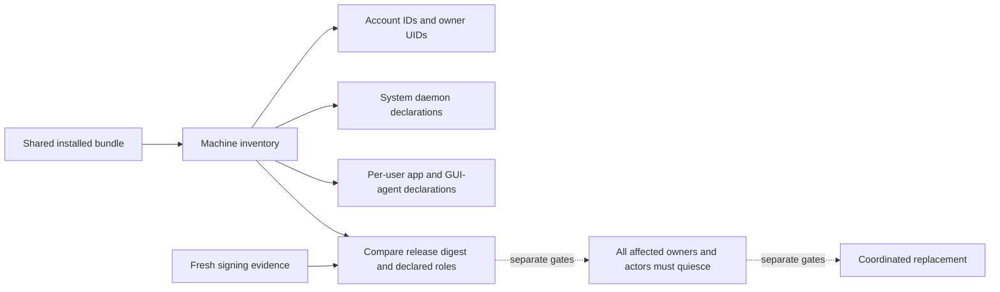

# Machine installation inventory

One installed bundle can serve several account contexts.
Update planning must retain those owners and their service domains separately from request journals.
The inventory now defines that bounded record, a guarded Root reader and durable storage under the machine writer lock.
It does not install services or prove that the recorded inventory is complete.

## Record and scope

Formats 1 and 2 use deterministic CBOR with the same exact fields.
Format 2 also permits a machine record before account enrollment.
It retains the Mac ID, installation ID, revision, absolute bundle path, release digest, account contexts and service declarations.
Accounts have unique account IDs and owner UIDs.
The record permits up to 64 accounts and 256 service declarations, within 65,536 bytes.
It never truncates excess records.

System daemons have no user-domain UID.
Authority and setup-controller declarations require Root execution.
Transport, gateway, tunnel and bridge declarations require a nonzero service UID that differs from every recorded interactive owner.
This is metadata validation; native account isolation still uses the separate startup checks.

Main-app registration uses the app role and its actual user domain, without a plist name.
GUI-agent registration uses the GUI role, matching user and execution UIDs, and a plist basename.
Each domain permits one declaration per account and role, with unique job labels.
Authority, transport and gateway declarations retain their configured account ID.
User declarations bind that ID to the domain owner.
Machine-wide optional roles can omit an account association.
Two accounts can retain distinct authority and transport jobs in the same system domain.
The same app label can occur in two distinct user domains.
This matches the SDK requirement to register agents from each user's session.

Configured inventory requires a system authority declaration.
The [machine bootstrap record](macos-machine-bootstrap-inventory.md) permits only the fixed setup declaration before account enrollment.
Missing optional role declarations do not establish that those roles have no running actors.
The complete-owner and complete-role checks remain installer and update-owner responsibilities.
Account IDs and UIDs do not prove directory-account continuity or grant command execution, enrollment or fleet management.

## Provenance and release comparison

Construction and decoding accept metadata only.
The native reader requires real and effective Root identity before accessing the supplied path.
It reuses protected local ancestry, private file, ACL, inode and timestamp checks.
It requires the expected Mac ID and performs no initialization, migration or repair.

The release digest uses a separate purpose and includes the canonical signed manifest, all component code hashes and all declared dependency hashes.
Incomplete or inconsistent signing evidence cannot produce a digest.
Comparison rejects changed code, missing declared roles and mismatched main-app identifiers.
Callers must obtain fresh evidence using the trusted publisher pins.

The signed app manifest declares inventory formats 1 and 2 for the authority and setup components.
It declares the explicit 1-to-2 transition. Other components do not claim inventory access.
The machine store has separate storage versions. Inventory records require storage version 2 or 3.
Opening a store never performs a storage upgrade.
No registration side effect is introduced.

## Integration gates

A Root-owned file alone does not prove current service registration, live process identity, code placement or generation floors.
The [service manifest matcher](macos-installation-service-manifests.md) checks planned plist fields against a retained declaration and exact release component.
The installer must obtain those bytes from the verified protected bundle and independently validate account names and configurations.
The [durable store](macos-durable-installation-inventory.md) now retains inventory with revision checks.
Its rows still do not establish installation completeness, current registration or live-process identity.
Inventory changes and admissions must serialize with update closure before this record can participate in activation.

Update readiness must inspect every affected account and role, including live GUI permits and actors.
A missing row, zero count, expired lease or eligibility status cannot establish quiescence.
The inventory grants no freeze, drain, replacement or rollback authority.
The approved automatic-update and optional-drain behavior stays unchanged.

Sixteen tests cover scope, canonical decoding, bounds, release changes, dependency bindings and ordinary-user refusal.
Signing-evidence fixtures use the internal constructor; they do not prove native signatures or installed registration.
Protected Root loading, service installation, pre-login operation and real update continuity remain platform gates.
