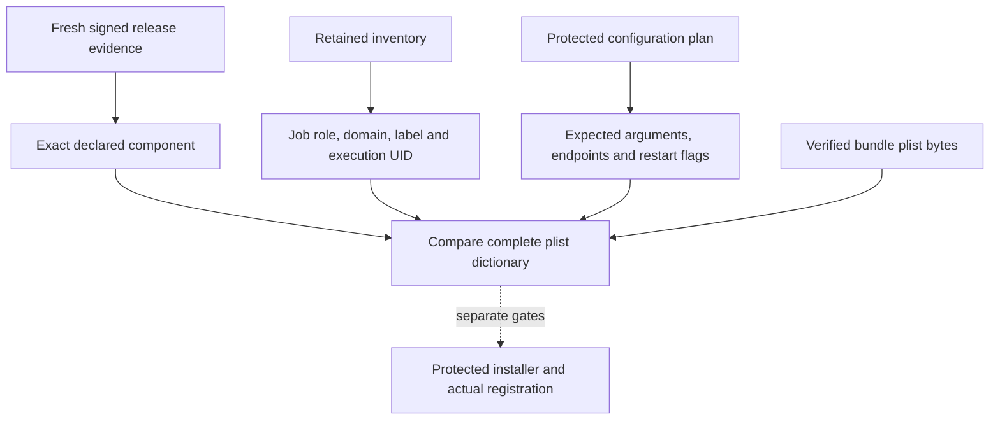

# Installation service manifest binding

`InstallationServiceManifest` compares a planned job with the plist bytes obtained from a freshly verified bundle.
It binds the job to a retained inventory declaration and the exact release component.
It grants no service registration, running-process or activation authority.

The supported job profile uses `BundleProgram`, exact arguments, a configuration path, explicit restart flags and optional Mach endpoints.
Configuration paths use the protected startup reader’s total and per-component byte limits.
Arguments have three slots: the declared executable, a supported mode and the configuration path.
Authority supports configuration and presence modes. Transport supports configuration, wake and remote modes.
Gateway supports configuration mode. Other planned profiles use configuration mode; their actual entry points remain an integration gate.
Daemon jobs specify an account name. Root declarations require `root`.
User agents omit `UserName` and use the Aqua session type.
The installer must independently resolve a daemon account name to its declared UID.
This matcher does not make that directory lookup or claim native account isolation.

The comparison rejects changed or missing fields and additional launch settings.
An alternate `Program` or injected environment cannot pass this profile.
Malformed, empty and oversized plists are rejected.
A constructor-selected component outside the verified release cannot pass validation.
The comparison does not read a path or authenticate arbitrary caller-supplied plist bytes.
Protected placement, fresh signature inspection, current configuration and retained generation floors remain prerequisites.

Nine focused tests cover matching metadata, tampering, malformed records, undeclared components, user agents and invalid expectations.
Signing evidence uses internal fixtures; these tests do not certify native signatures or installed launchd jobs.
The current product app does not select this profile or register a service.
Complete owner enumeration, account configuration matching and coordinated activation remain pending.
