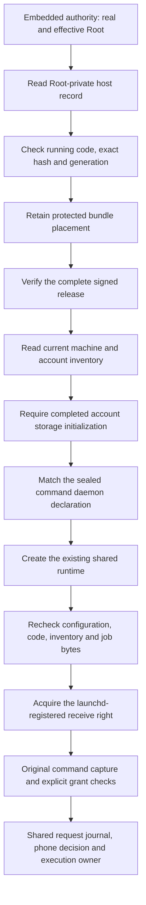

# Installed command authority

The embedded authority accepts `--command-configuration` with a protected host record.
This selects the existing request, presence, command receiver and execution owner.
The earlier trust and presence modes remain available. Command startup has no fallback to either mode.

The host record binds the installation, current release, code policy, account, job label and plist name.
It requires execution configuration. An admission-only record cannot select this installed mode.
App, transport and gateway peer requirements must match the current retained component hashes.
The monitor and child paths must name the components in the same verified bundle.
A newer signed candidate cannot replace the retained installed generation or hash during startup.

The machine store must contain the matching account and Root daemon declaration.
Its completed initialization must name the configured journal and continuity files.
This record does not replace the journal's own continuity, hardware signer or current policy checks.
The signed daemon binds the configuration argument and the request, presence and command Mach names.
The factory rechecks those inputs immediately before native check-in.
Native check-in provides a registered receive right. The factory creates no anonymous receive right.
Check-in alone does not establish installation, signing, account scope or retained floors.

The runtime shares its existing journal, continuous clock and execution scheduler.
It still captures the original command and reads explicit current caller/target grants.
A phone approval does not bypass final capture, enrollment, code, credential or release checks.
Shutdown drains the runtime before closing the registration owner's machine store and placement lease.
Each startup attempt reloads protected inputs. No failed attempt adopts a different startup mode.

## Evidence and remaining gates

Focused controls check canonical host input, required execution and code roles, retained release and account mismatches,
executor paths, exact Mach names, and ordinary-user refusal before configuration access or native check-in.
Build checks verify the new mode's ordinary-user refusal and the sealed daemon bytes in both app configurations.
These checks do not install the daemon or execute a Root command.

[The synthetic live XPC run](experiments/evidence/2026-10-14-command-entrypoint-xpc.json) passed all 19 cases on macOS 27.0.1.
The temporary per-user agent was removed. Its report records exact source hashes and the pending continuity guards.
The live probe and its imported selector declaration match the merged base.
This verifies existing selector bridging and handshake behavior with ad-hoc signatures.
It does not test the new registered Root receive right or replace installed IPC evidence.

The native API does not register a job, create an account, provision a key or initialize storage.
Actual first installation remains blocked by [issue 363](https://github.com/rock3r/remozio/issues/363).
Installed code and IPC evidence remains open in [issue 286](https://github.com/rock3r/remozio/issues/286).
Target credential and file-access semantics remain open in [issue 298](https://github.com/rock3r/remozio/issues/298).
Neither a protected record nor a green unit suite proves those native gates.
Usable setup, Mac–Pixel pairing and the first real approval test remain required integration work.
