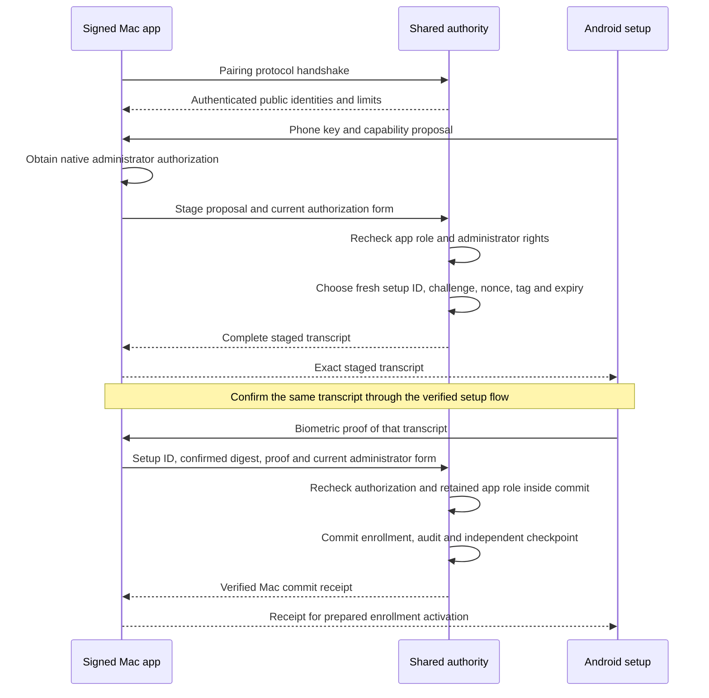

# Local pairing setup channel

The configured authority now stages phone enrollment through the signed Mac app channel. It shares the request journal, audit writer, checkpoint and existing Secure Enclave signer.

## Configuration and compatibility

Pairing is explicit in Root-private startup configuration. Presence startup schema 1 remains byte-compatible when pairing is absent. Schema 2 requires a strict pairing configuration. Unknown versions, mixed fields and missing configuration fail without fallback.

The pairing configuration pins the existing Mac transport public key and sets an attempt lifetime. The default is 120 seconds. The supported range is 1 through 300000 milliseconds. Provisioning must supply the correct local transport pin; a peer cannot select it.

The existing app Mach channel and presence selectors remain unchanged. Its optional combined interface adds a separate version 1 pairing handshake. Pairing remains inaccessible to the dedicated transport account and network peers. The connection registry and work budget retain their existing bounds.

## Authorization and ownership

`AuthorityPairingChannel.start` authenticates the Root endpoint before the caller exports an administrator form. The client then validates its public context against the protected Mac/account metadata. It never displays an administrator dialog or retries a commit automatically.

Only a verified signed app invocation can stage or commit. Root imports current native administrator rights on the original exported invocation stack. No external form is retained in the staged attempt or returned to the phone.

The proposal supplies phone claims only. Root rebuilds the Mac offer from current allowed contracts and creates fresh setup values. Its authority key, transport pin, revision, lifetime and protocol floor come from trusted local state. Its audit versions match the configured service and live channel offers. The app and phone must verify the returned transcript, not the proposal.

Each connection retains at most one uncommitted attempt. Commit requires its setup ID, exact confirmed digest and phone biometric proof. The Root transaction rechecks the app role and administrator rights. Signing uses the existing checkpointed pairing path only after durable success.

The client rejects changed phone claims, wrong Root pins, crossed context, invalid receipts and unsupported versions. It clears its commit slot before sending. A timeout or lost reply remains ambiguous; recover the receipt through the authenticated phone path instead of enrolling again.

Cancellation discards only an uncommitted attempt. It requires no biometric or administrator form. Disconnect does the same. It does not revoke a committed enrollment or alter another presence connection.

## Evidence and remaining work

Nineteen pairing controls cover configuration bounds, fresh Root values, authorization, confirmation, expiry, cancellation, crossed connections, policy changes and client lifecycle. Two additional controls cover startup compatibility. The anonymous native XPC test verifies the legacy presence handshake, new pairing selectors and original-invocation kernel identity checks.

Native wire tests pin the running test binary and use same-user disposable stores. They use software fixture signatures and logical administrator checks. They do not establish deployed Root identity, Developer ID enforcement, hardware custody or native administrator consent.

The local setup channel currently stages additions. The existing lower-level replacement API remains available, but replacement setup still needs its complete gateway and recovery integration.

Phone invitation delivery, QR/text presentation, the Mac setup UI and Android activation UI remain to be connected. Protected installation, actual credentials and installed IPC remain native gates. No protected service registration, OS account change or physical Mac–Pixel approval ran for this change.
