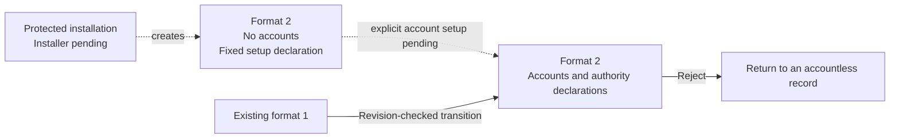

# Machine inventory before account enrollment

Inventory format 2 describes an installation before account enrollment.
First installation must not infer an account or grant command execution.
The package installer and account enrollment flow remain unfinished.

The record is metadata. It proves no installation, registration, signed process or administrator consent.

| Format | Account scope | Required declarations |
| --- | --- | --- |
| 1 | At least one account | A system authority daemon |
| 2, before enrollment | No accounts | Only the fixed Root setup daemon |
| 2, after enrollment | At least one account | Existing account and authority checks |

`machineBootstrap` constructs only the fixed setup declaration.
It uses the same Mac ID, installation ID, release digest, bundle path and record bounds.
The decoder retains format 1 support. Legacy readers reject format 2.
The signed manifest declares both formats and their explicit transition for the two storage readers.

The machine writer retains the selected format when it generates a fresh revision.
Replacement still requires the current revision and installation identity.
It rejects a format downgrade and a return to an accountless record after enrollment.
A failed commit retires the connection. A fresh read can observe the committed bootstrap record without recreating it.

The account setup owner still requires an account ID bound to the caller UID.
A bootstrap record cannot infer that binding from the current process or authorize account progress.
Explicit enrollment, role provisioning, keys, configuration publication and service registration remain separate work.

Eight native controls cover record scope, legacy decoding, release comparison, persistence, account refusal and uncertain commits.
They use ordinary-owner storage and synthetic signing evidence.
They do not prove Root isolation, installed services, hardware keys or the first Mac–Pixel approval flow.
