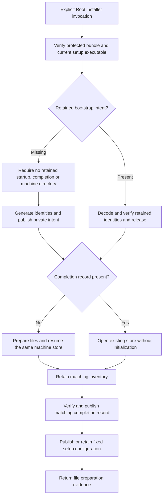

# Resumable machine bootstrap

The explicit installer entry point now prepares the machine store and the fixed setup configuration.
It retains one installation identity across interrupted attempts.
It does not enroll an account, create a key, grant command access or register a service.

The production entry point requires real and effective Root identities.
The expected Team ID comes from the installer configuration, not the candidate manifest.
It checks the protected bundle, signed release, setup executable hash, security generation and actual executable path.
Those checks repeat at storage and publication boundaries.

The fixed bundle is `/Library/Application Support/Remozio/Applications/Remozio.app`.
The machine store is `/Library/Application Support/Remozio/Machine`.
The private files share the protected `/Library/Application Support/Remozio` parent:

| File | Meaning |
| --- | --- |
| `bootstrap-intent.cbor` | Frozen machine IDs, initial inventory, release digest and setup policy. |
| `bootstrap-complete.cbor` | The same intent, published after the matching inventory commits. |
| `setup.cbor` | Startup configuration for the bundled administrative host. |

A fresh attempt publishes the intent before creating the machine files.
An existing machine directory without that intent is refused.
A retry reads the retained IDs and verifies the same signed release.
It synchronizes the validated intent file before further storage writes.
Both bootstrap records use format version 1 and reject unknown versions or fields.
It never selects replacement IDs to make an existing store open.

Before completion, an empty store can initialize under the retained intent.
A known identity can resume the explicit inventory schema upgrade.
Unknown schema, corrupted data, conflicting inventory and another machine identity are refused.
The existing store initializer still requires an empty schema before creating tables.

After completion, bootstrap cannot create missing database files or initialize an empty replacement database.
Replays preserve enrolled account metadata and the current inventory revision.
A missing intent, conflicting marker or startup file without completion stops the operation.
The controller rechecks retained proof before each mutation.
Completion observed from another attempt also disables initialization and file preparation.
The completed phase cannot move backward during an attempt.
It holds the machine writer lease through completion and startup publication.

A lost commit acknowledgment leaves the connection unavailable.
A fresh attempt can read the committed inventory without replacing it.
A failed publication can retain its correct named file.
The existing exclusive publisher synchronizes and validates matching files on retry.
These records do not provide an independent witness against an entire matching backup restoration.

The bundled setup executable accepts `--bootstrap-installation PUBLISHER_TEAM_ID` for the installer operation.
Ordinary `--configuration` startup still reads existing state only.
The explicit operation grants no service health or command admission result.

Fifteen same-owner controls use actual private files and SQLite stores.
They cover every interruption stage, lost acknowledgment, schema recovery, changed release evidence, replaced parents and retained account metadata.
The public API and both app configurations reject an ordinary user before protected operations.
These controls do not prove privileged installation, power-loss recovery, native administrator consent or service activation.

The `.pkg` build driver and its payload replacement, resume and visible app placement controls remain pending in issue #363.
Account enrollment, dedicated service accounts, authority keys, runtime configuration and production registration also remain pending.
Do not treat this entry point as a complete first installation or a working Mac–Pixel flow.
