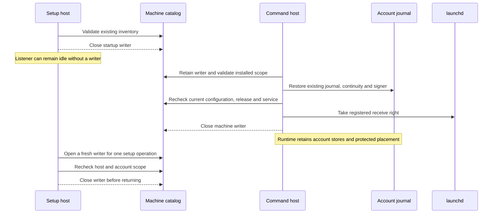

# Machine-store ownership during service startup

The setup and command hosts share one machine catalog.
They acquire the existing exclusive writer rather than keeping two lifetime writers.
The file, identity, local-mount and single-writer checks remain unchanged.

Setup startup validates the protected configuration, actual running code, signed release and current inventory.
It closes that initial connection before constructing the scoped owner.
Every later owner operation opens existing storage, checks the retained installation and release, then closes the connection.
Progress and resume also check the current account binding.
The host repeats its configuration, signing, placement and sealed service checks through the existing validation callback.
The owner rejects a replaced installation instead of adopting its identity.
It serializes its own operations and rejects use after close or a process change.

The command registration keeps the machine writer through journal restoration and native check-in.
Check-in happens in the receive worker's startup callback.
The registration repeats its complete installed validation before calling the native API.
It releases the machine writer only after that API returns a receive right.
The receive host then owns that right.
If releasing the store fails, the handoff disposes the untransferred receive right.
A failed check-in leaves the machine connection with the existing startup cleanup owner.

| Resource | Retained lifetime |
| --- | --- |
| Setup machine writer | One startup check or owner operation |
| Command machine writer | Installed startup through validated check-in |
| Command receive right | Receive host lifetime |
| Account journal and continuity | Existing command runtime lifetime |
| Protected bundle placement | Existing host lifetime |

An idle setup host therefore cannot block command startup forever.
A command startup can briefly return writer-busy while setup owns an operation.
The existing runtime retry path handles that temporary lease error.
Machine SQLite busy, I/O, disk-full and interruption errors also retain their temporary classification.
Wrong identity, unsupported schema and corruption remain permanent refusals.

Releasing machine bookkeeping is not update-quiescence proof.
Updates must still stop admission, drain owned work and establish the required service and account-store quiescence before activation.
This change does not release an account journal, reset a code floor, replace protected configuration or authorize an update.
Current elevation policy remains a fresh protected-file check at admission and execution.
No new manual service-stop or re-pairing step is introduced.

## Evidence and limits

The scoped controls use actual same-owner SQLite files and exclusive locks.
They cover idle owners, both startup orders, contention, failure cleanup, fresh inventory, changed account ownership and replaced installation identity.
They also cover owner restart and preservation of the retained initialization intent.
The endpoint fixture runs the actual storage controller through scoped access and retains completion across an owner restart.
Its administrator authorization is synthetic.

Handoff controls transfer a real task-local receive right and retain an independent protected journal lease.
They check successful release, failed check-in ownership and disposal after failed store release.
Those task-local ports are not registered Root services.
The retained-connection initializer remains an internal seam for older logical endpoint controls; production uses the scoped factory.

These controls do not prove privileged coexistence, native administrator consent, launchd registration or update activation.
The installed setup and command hosts still need the interactive #286/#363 checks.
Native credential semantics remain open in #298.
The first Mac–Pixel approval flow also needs real account enrollment, role identities, keys, explicit grants and runtime configuration.
