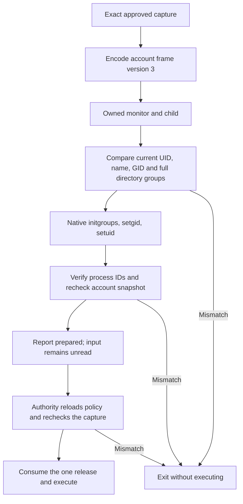

# Native account credentials

The command child uses the native `initgroups` API to initialize the approved directory account.
This preserves normal account membership beyond the static group limit.
The signed capture still retains the full account name, UID, primary GID and sorted directory groups. No group is removed from the capture.

## Measured choice

The [privileged experiment](experiments/evidence/2026-10-16-command-groups-privileged.json) ran disposable children on macOS 27.0.1.
Full static lists failed for Root and the ordinary account. A bounded static subset lost access to the extra-group file. Native initialization preserved access.
Root initialization also succeeded. The POSIX query reported 16 groups; the extended query reported all 24 directory groups.
The extended ordinary query reported 17 even after static initialization lost access. A group count alone therefore cannot prove membership behavior.

[Apple Libinfo](https://github.com/apple-oss-distributions/Libinfo/blob/main/lookup.subproj/libinfo.c) initializes a bounded static list with a separate membership UID.
[Apple XNU](https://github.com/apple-oss-distributions/xnu/blob/main/bsd/kern/kern_prot.c) treats explicit static groups differently from directory membership.
The production child uses the native account API. It has no `setgroups` fallback.

## Private child protocol

The common 40-byte header retains UID, GID, group and string counts, preparation budget, creation mask and I/O mode.
Version 3 uses magic `RMC3`. Its body contains the terminal mask, full group vector, account name, executable, arguments and environment.
Strings retain their existing length prefixes and NUL refusal. The account name is nonempty and bounded to 65,535 bytes.
The group vector has 1–1,024 distinct IDs in ascending order. It includes the primary GID and rejects the invalid-ID sentinel.
Pipe, legacy terminal and mapped terminal layouts retain their existing stream meanings.

| Component | Supported private child formats |
| --- | --- |
| Production Swift encoder | 3 |
| Native decoder and monitor | 1, 2, 3 |
| Production credential validator and child | 3 |
| Explicit legacy fixture encoder | 1, 2 |

Unknown versions fail. The production child refuses historical static-group frames before applying credentials.
The static-group helper also refuses version 3. It cannot truncate the directory vector into a legacy representation.
An older monitor refuses the new magic. A newer monitor cannot make an old frame execute through the production child.
These bytes remain private Root-to-child data. They grant no enrollment or execution authority. The phone protocol and capture schema stay unchanged.

## Identity and lifetime

The child checks UID-to-name and name-to-UID lookup before initialization. Both must match the captured UID, name and primary GID.
It resolves and compares the complete current directory group set. Missing accounts, aliases with another identity and changed membership fail closed.
Successful initialization precedes `setgid` and `setuid`. The child verifies its real and effective IDs and repeats the directory check afterward.
A failed step terminates the child. It cannot report prepared or consume a release.

The OS account directory remains trusted. Checks do not freeze future administrator changes or the OS membership cache.
The authority retains its existing policy and capture rechecks before spawn and release. No grant, signature or first-decision check is bypassed.
Directory calls run inside the owned child. Existing monitor deadlines and cancellation retain responsibility for terminating and reaping that child.
Descriptors used by initialization close before preparation. The target cannot inherit the private configuration, status or release channels.

## Evidence and limits

Ordinary-user tests validate actual Root and current-account snapshots without changing credentials.
A separate fixture substitutes credential APIs only at compile time. It verifies all transition failures and ordering without privileged operations.
Codec tests cover full vectors, target changes, malformed frames, unsupported versions and legacy rejection. Existing pipe and terminal controls remain required.

The retained privileged results establish native API behavior. They do not run this production child or an installed command service.
Production child execution, installed service identities and the full Mac–Pixel approval flow remain interactive gates.
The local privileged measurement does not establish macOS 26 behavior. Keep [issue #298](https://github.com/rock3r/remozio/issues/298) open until the actual child path is measured.
