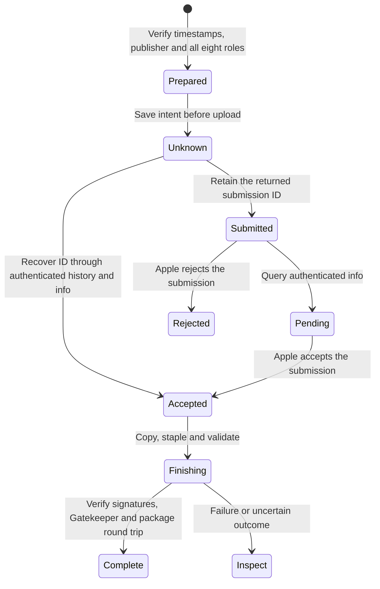

# Local notarized app candidates

Use this workflow before testing the bundled setup daemon. It prepares files only. It never installs an app or registers services.
The app uses Developer ID distribution. This does not publish it to the App Store.



## Prepare one candidate

Commit the source first. Build the Release app from that commit with `python3 scripts/check-macos-app.py`.
Use an explicitly approved certificate fingerprint and an independently trusted Team ID.
The signing key stays in the Keychain. The workflow accepts a named local notary profile, never a password or private key.

```sh
python3 scripts/run-macos-release-signing-experiment.py \
  --signing-identity CERTIFICATE_SHA1 --trusted-team TEAM_ID \
  --secure-timestamp --export-app .build/Remozio-timestamped.app
python3 scripts/prepare-macos-notarized-candidate.py prepare \
  --app .build/Remozio-timestamped.app --trusted-team TEAM_ID \
  --workspace .build/notary-candidate
```

Both output paths must be new. Secure timestamps need network access.
The default signing experiment still omits timestamps and performs no notarization.
The notarization workflow refuses missing timestamps, unexpected publishers and incomplete signatures.
It checks every executable through the production release inspector.

The private workspace contains a copied app, a uniquely named submission archive and a durable journal.
The journal records the source commit, tree, tool hashes, publisher, app fingerprint and archive hash.
Keep the workspace on the same source commit throughout this workflow. Source changes stop continuation.
The source record identifies the preparation code. Build provenance still depends on the explicit same-commit build step.

## Submit and check the result

Replace `LOCAL_NOTARY_PROFILE` with the existing Keychain profile name.
No credential values enter the journal or tool output.

```sh
python3 scripts/prepare-macos-notarized-candidate.py submit \
  --workspace .build/notary-candidate --keychain-profile LOCAL_NOTARY_PROFILE
python3 scripts/prepare-macos-notarized-candidate.py status \
  --workspace .build/notary-candidate --keychain-profile LOCAL_NOTARY_PROFILE
```

Submission records uncertainty before it starts the upload. Each workspace permits one upload attempt.
An upload timeout, crash or malformed reply leaves that attempt uncertain. Do not submit again or create a replacement workspace blindly.
An upload receipt can contain an ID without a processing status. The journal retains that ID and records the status as Unknown.
Run `status` to obtain the authenticated processing result. A pending result remains pending.

If the upload reply lost its ID, inspect authenticated history:

```sh
xcrun notarytool history --keychain-profile LOCAL_NOTARY_PROFILE --output-format json
python3 scripts/prepare-macos-notarized-candidate.py status \
  --workspace .build/notary-candidate --keychain-profile LOCAL_NOTARY_PROFILE \
  --submission-id RECOVERED_SUBMISSION_UUID
```

Match the exact unique archive name from the private journal. The status command independently verifies the authenticated ID and name.
It refuses a different ID once one is recorded. A rejected result cannot proceed to packaging.

## Finish an accepted candidate

```sh
python3 scripts/prepare-macos-notarized-candidate.py finish \
  --workspace .build/notary-candidate
```

The command preserves the submitted app and creates a separate stapled copy.
Only the stapler child uses umask `022`, so its new ticket is readable. The journal stays private with mode `0600`.
The command validates the ticket, every signature, the release pins and Gatekeeper assessment.
The package producer sets its new payload parent to `0755`, independently of the private workspace umask.
It then builds the unsigned local package and repeats ticket, signature and Gatekeeper checks after full package extraction.
The final journal records the package hash and each proven boundary.

The package contains a notarized app. The package itself remains unsigned and has no package notarization claim.
A failure during finishing retains the workspace and its last stage. Inspect that result before any further action.
A status query cannot clear an uncertain finishing result or authorize an automatic retry.

## Limits

The tool never retrieves vault secrets, launches the app, changes protected installation files or creates a machine identity.
A complete journal proves candidate preparation and archive composition. It does not prove native installation, service registration or an approval flow.
The initial package still refuses a different installed release. Follow its verified transition procedure separately.
Sparkle distribution and signed public packages remain later release work.

The [16 October 2026 control](experiments/evidence/2026-10-16-notarized-candidate.json) records one accepted live submission and authenticated ID recovery.
It also records the private-umask package fix and its actual archive checks. No app was installed or launched.
