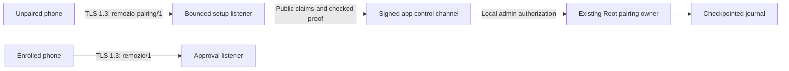

# Mac pairing setup exchange

The transport component can accept an unpaired phone without admitting it to the approval listener.
Its handler receives a proposal bound to the actual TLS client key.
Only the signed app can authorize enrollment through its authenticated Root channel.

Construct `PairingSetupListener` in the transport role with its existing TLS identity and the invitation from authenticated Root context.
Forward the checked proposal to the app. Call `AuthorityPairingChannel.stage(_:authorization:)` through the existing authorized local connection.
Pass the actual returned transcript to `PairingSetupNetworkSession.stage`. The app and phone must confirm that complete transcript independently.

After `receiveProof`, the app commits through its retained Root setup channel with the confirmed digest and administrator authorization.
Pass only the resulting durable receipt to `sendReceipt`. The network owner never commits enrollment itself.
A lost receipt cannot trigger another commit. Keep the Android PREPARED record for explicit recovery.

Call `closeAndWait` before treating the listener as quiescent. It waits for the actual handler tasks after aborting their I/O and cancelling them.
The handler must propagate cancellation into its app control exchange. It must not create detached work that outlives the listener.

The [local app control channel](macos-pairing-control.md) connects these components through explicit protected transport startup.
The setup UI, Android hardware setup composition, configuration publication, and installed-service validation remain required before interactive pairing.
See the [wire contract](../protocol/pairing-setup.md) for formats, limits, authorization, and evidence boundaries.
