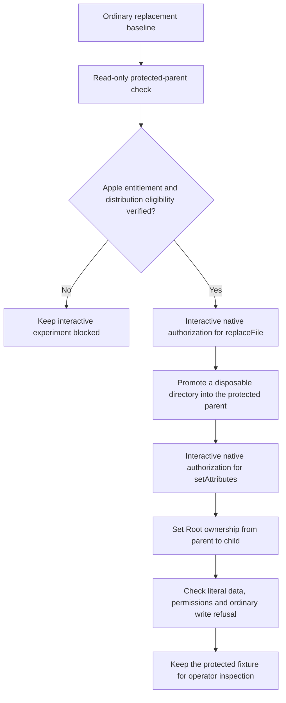

# Native file operations for protected bootstrap

This experiment tests native file operations that a first-install flow could use.
It does not select the product installer or setup interface.
The app needs a protected bundle before the configured administrative host can serve requests.
Apple exposes authorization for atomic replacement and limited ownership and permission changes through NSWorkspace and FileManager.
Its authorization does not enable general privileged directory creation or copying.

## Apple availability gate

Apple requires `com.apple.developer.security.privileged-file-operations` before the app can request authorization.
Apple documents entitlement requests for apps on, or intended for, the Mac App Store.
Its availability for this Developer ID homelab app remains unverified. A signing certificate alone does not establish eligibility.
The ordinary artifact has no privileged entitlement. It refuses interactive mode before creating a fixture or showing a prompt.
Do not inject the entitlement into an ad-hoc signature to bypass this gate.
This experiment does not change Remozio's distribution plan or select a different setup flow.



## Measured without administrator authorization

| Case | macOS 27.0.1 result | Ownership and permissions |
| --- | --- | --- |
| Replace an existing file | Success | Original target mode retained |
| Replace a missing file | Success if its parent exists | Source owner and mode retained |
| Replace an existing directory | Success | Original target mode retained |
| Replace a missing directory | Success if its parent exists | Source owner and mode retained |
| Replace under a missing parent | Refused | Source retained; no target created |

All five cases use ordinary-user directories and literal test data under `/private/tmp`.
The harness verifies cleanup after the ordinary cases. It also checks that incomplete confirmation flags do not consume stdin or prompt.
The read-only preflight checks the fixed parent, its ancestry, local filesystem, ownership, modes and ACLs.
It creates no protected file and changes no permission. The current local parent passes that check.
The probe targets macOS 26 on Apple Silicon. Runtime evidence currently comes from macOS 27.0.1.

Run the noninteractive gate with `python3 scripts/run-native-bootstrap-file-experiment.py`.
It builds the signed development app and writes `.build/protected-bootstrap/ordinary-evidence.json`.
The normal repository gate runs only these noninteractive checks.
Python controls reject altered evidence, mismatched signing profiles and unexpected entitlements.
The default signature checks for other Mac artifacts remain unchanged.

## Prepared interactive procedure

First establish Apple approval and distribution eligibility for the probe's exact app identifier.
Then prepare the interactive artifact with its approved profile and matching certificate:

```sh
python3 scripts/run-native-bootstrap-file-experiment.py \
  --interactive-signing-identity <certificate-SHA1> \
  --provisioning-profile <approved-profile-path> \
  --team-id <Apple-Team-ID>
```

The builder checks the profile's team, app identifier, certificate, expiration and privileged entitlement.
It preserves the profile's App ID prefix, which can differ from its Team ID.
These field checks do not establish Apple approval. Platform validation and the live authorization result remain separate gates.
The builder verifies the signature and exact entitlements. It runs only modes that require no authorization.
It records `interactive-signing-evidence.json`, which does not claim a successful privileged operation.

Run this only during the agreed interactive Mac session, after those gates pass:

```sh
.build/protected-bootstrap/RemozioBootstrapProbeInteractive.app/Contents/MacOS/remozio-bootstrap-probe \
  --authorize-file-operations --confirm-disposable-only
```

The app uses only a generated `/Library/Application Support/RemozioBootstrapProbe-<UUID>` destination and disposable literal data.
It refuses an existing target, unsafe ancestry, symlinks, hard-linked files and unexpected fixture contents.
No caller supplies a destination. It creates no OS account, service registration, authority key or product configuration.
It launches no Remozio Root code. Apple handles each authorization and delegated filesystem operation.
The probe prints its disposable paths to stderr before requesting authorization. Retain that scope record if the process is interrupted.

The test requests `replaceFile` and `setAttributes`. Count the actual visible prompts separately; two API requests do not prove two prompts.
Check successful promotion, resulting ownership, Root normalization, ordinary write refusal and the reported errors.
Cancel at each authorization stage in separate runs. Do not automatically retry a failed or lost operation.
An unexpected promotion owner or inaccessible contents remain evidence to investigate, not a reason to relax validation.

The probe leaves any protected fixture for inspection. It does not attempt privileged cleanup through an unprotected target.
Read `disposableDestination` from the result and remove only that exact generated directory after inspection.
A cancelled or failed operation may still leave a fixture. `cleanupComplete` must be true before treating cleanup as finished.
Native cancellation, directory promotion, ownership normalization, write refusal and the actual prompt count remain unrun.
Neither ordinary evidence nor successful signing proves Developer ID entitlement eligibility or final setup behavior.

## Decision gate

Verify protected placement against the product checks in a fresh process before adopting this approach.
Then verify service registration and authenticate the setup host before sending administrator credentials.
Measure prompt count, cancellation, interruption, stale paths and recovery before proposing a setup flow.
The checks do not prove atomic path binding inside the authorized FileManager calls. Test source replacement races before production use.
Consult the user before adding prompts or other UX costs beyond the approved setup behavior.

Official API references: [privileged entitlement](https://developer.apple.com/documentation/bundleresources/entitlements/com.apple.developer.security.privileged-file-operations),
[authorization types](https://developer.apple.com/documentation/appkit/nsworkspace/authorizationtype),
[authorization requests](https://developer.apple.com/documentation/appkit/nsworkspace/requestauthorization%28to%3Acompletionhandler%3A%29).
The current SDK's `NSWorkspace.h` lists the supported FileManager methods and owner, group and permission attributes.
