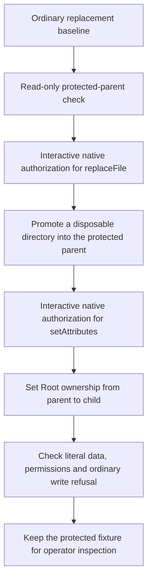

# Native file operations for protected bootstrap

This experiment tests a possible first-install building block. It selects no product installer or setup UX.
The app needs a protected bundle before the configured administrative host can serve.
Apple exposes authorization for atomic replacement and limited ownership and permission changes through NSWorkspace and FileManager.
Its authorization does not enable general privileged directory creation or copying.



## Measured without administrator authorization

| Case | macOS 27.0.1 result | Ownership and permissions |
| --- | --- | --- |
| Replace an existing file | Success | Original target mode retained |
| Replace a missing file | Success if its parent exists | Source owner and mode retained |
| Replace an existing directory | Success | Original target mode retained |
| Replace a missing directory | Success if its parent exists | Source owner and mode retained |
| Replace under a missing parent | Refused | Source retained; no target created |

All five cases use ordinary-user directories and literal test data under `/private/tmp`.
The harness verifies cleanup after the ordinary cases. It also checks that incomplete confirmation flags do not consume stdin or prompt.
The read-only preflight checks the fixed parent, its ancestry, local filesystem, ownership, modes and ACLs.
It creates no protected file and changes no permission. The current local parent passes that check.
The probe targets macOS 26 on Apple Silicon. Runtime evidence currently comes from macOS 27.0.1.

Run the noninteractive gate with `python3 scripts/run-native-bootstrap-file-experiment.py`.
It builds the signed development app and writes `.build/protected-bootstrap/ordinary-evidence.json`.
The normal repository gate runs only these noninteractive checks.
Five Python controls reject incomplete, altered or incorrectly classified evidence.

## Prepared interactive procedure

Run this only during the agreed interactive Mac session:

```sh
.build/protected-bootstrap/RemozioBootstrapProbe.app/Contents/MacOS/remozio-bootstrap-probe \
  --authorize-file-operations --confirm-disposable-only
```

The app uses only a generated `/Library/Application Support/RemozioBootstrapProbe-<UUID>` destination and disposable literal data.
It refuses an existing target, unsafe ancestry, symlinks, hard-linked files and unexpected fixture contents.
No caller supplies a destination. It creates no OS account, service registration, authority key or product configuration.
It launches no Remozio Root code. Apple handles each authorization and delegated filesystem operation.
The probe prints its disposable paths to stderr before requesting authorization. Retain that scope record if the process is interrupted.

The test requests `replaceFile` and `setAttributes`. Count the actual visible prompts separately; two API requests do not prove two prompts.
Check successful promotion, resulting ownership, Root normalization, ordinary write refusal and the reported errors.
Cancel at each authorization stage in separate runs. Do not automatically retry a failed or lost operation.
An unexpected promotion owner or inaccessible contents remain evidence to investigate, not a reason to relax validation.

The probe leaves any protected fixture for inspection. It does not attempt privileged cleanup through an unprotected target.
Read `disposableDestination` from the result and remove only that exact generated directory after inspection.
A cancelled or failed operation may still leave a fixture. `cleanupComplete` must be true before treating cleanup as finished.
Native cancellation, directory promotion, ownership normalization, write refusal and the actual prompt count remain unrun.
Ad-hoc development signing does not prove the final Developer ID setup behavior.

## Decision gate

Verify protected placement against the product checks in a fresh process before adopting this approach.
Then verify service registration and authenticate the setup host before sending administrator credentials.
Measure prompt count, cancellation, interruption, stale paths and recovery before proposing a setup flow.
The checks do not prove atomic path binding inside the authorized FileManager calls. Test source replacement races before production use.
Consult the user before adding prompts or other UX costs beyond the approved setup behavior.

Official API references: [authorization types](https://developer.apple.com/documentation/appkit/nsworkspace/authorizationtype),
[authorization requests](https://developer.apple.com/documentation/appkit/nsworkspace/requestauthorization%28to%3Acompletionhandler%3A%29).
The current SDK's `NSWorkspace.h` lists the supported FileManager methods and owner, group and permission attributes.
