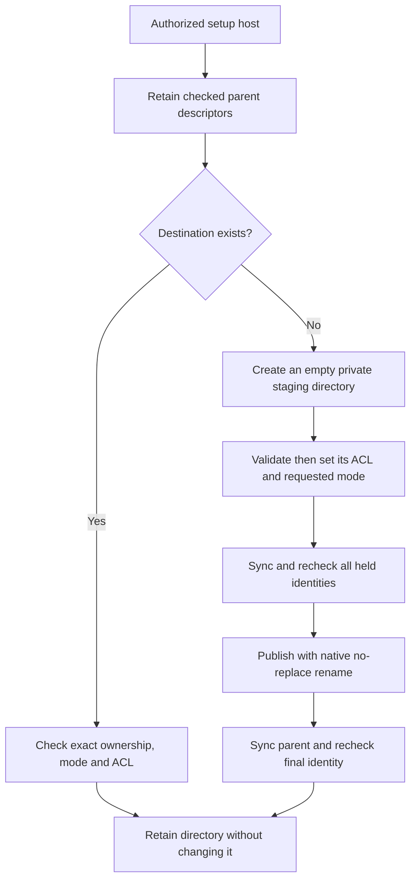

# Protected directories for Mac setup

`ProtectedSetupDirectory.createOrOpen` creates one directory under existing protected parents.
Both process identities must be Root before the API accesses any path.
The setup controller must separately establish administrator authorization, trusted code placement and the requested scope.

Private state uses mode 0700. Shared metadata uses mode 0755 so ordinary clients can traverse the container.
Shared ancestry must permit ordinary directory reads, search and metadata inspection.
Applicable ACL denials of those operations cause refusal before creation or retire an existing lease.
Unrelated deletion denials and inheritance-only entries remain accepted. Ancestor permissions and ACLs are never rewritten.
Files still need their own ownership, confidentiality and publication checks.
Creation starts with an empty staging directory. It removes inherited ACL entries only from that new object.
An existing destination never receives chmod, chown, ACL repair or replacement.
Unsafe metadata, symlinks, missing parents, remote mounts and changed inode identities cause refusal.

The returned object retains the ancestry and final directory descriptors.
Callers serialize its use and call `validate` before using its path.
A failed identity or metadata check retires the object. Closure releases descriptors; it deletes no state.
Configuration readers and key provisioning must still perform their own fresh path and scope checks.

If another operation creates the destination before publication, the native rename refuses to replace it.
A complete publication followed by an interrupted return can reopen the same directory.
A prepared interruption leaves an empty staging directory; a new attempt can create the final directory without adopting that staging object.
Unknown remnants are preserved. This API does not delete or rotate retained state.
Directory synchronization is implemented, but the controls do not prove power-loss durability.

Seventeen ordinary-owner controls cover private and shared visibility, retained contents and permissions, inherited ACL handling, symlinks, missing parents, replaced ancestry and interrupted publication.
Removing native no-replace protection causes the empty-destination regression control to fail.
Restoring it passes the focused suite. The fixtures create no Root state or production key. Cross-UID reading remains an interactive check; the reader fixture uses one UID.

The product setup controller still needs to compose this API with account creation, configuration publication and service registration.
Real Root placement, installed behavior and physical Mac–Pixel approval remain interactive gates.
