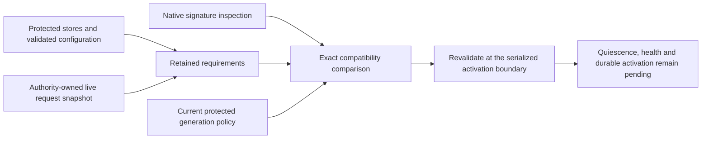

# Retained release compatibility checks

The compatibility preflight compares a signed candidate with retained format and request requirements.
It first checks the existing identity and generation policy.
A passing comparison grants no installation, migration or activation authority.

## Exact requirements

| Requirement | Candidate check |
| --- | --- |
| Component role | The required role exists in the inspected candidate. |
| Stored format | The named declaration contains every required reader version. |
| Writer selection | The declaration contains every selected writer version. |
| Request contract | Kind, wire version and capture schema match exactly. |
| Actions and signing purposes | The candidate supports every retained action and purpose. |
| Security features | The candidate declares every retained required feature. |

Sparse sets remain sparse. Readers `{2, 5}` cannot read version 3.
A migration edge does not count as reader support or authorize a migration.
The installation owner must implement and authorize any migration separately.
It must verify the resulting storage and retain a safe recovery path.

Each role permits at most 32 format requirements and 32 request requirements.
Format reader and writer sets each permit at most 32 positive versions.
Duplicate requirements fail construction. The total ceiling is 384 requirements in each category.
These bounds match the existing twelve-role catalog and declaration limits.

The owner must derive complete requirements from protected stores, validated configuration and current live state.
The candidate cannot choose these inputs.
An empty comparison is not evidence that the installation has no retained state.
Recheck requirements and policy when activation begins; a staging snapshot is insufficient.
Live-request snapshot composition and the activation transaction remain integration work.

## Versioned feature declarations

Schema 3 adds request-contract key 5: a sorted, unique feature set with at most 32 entries.
Every schema 3 request contract includes this key, including an explicit empty set.
Schema 3 retains the schema 2 dependency layout and existing signature and inventory checks.
Schemas 1 and 2 keep their original bytes and imply no declared feature support.
They cannot satisfy a nonempty required-feature set.
A manifest with feature declarations uses schema 3. Decoding preserves the observed schema.
Old readers reject schema 3 instead of ignoring its new field.
The current product still emits schema 1 because its implemented contracts require no extra features.

Features belong to each exact request contract. Matching wire and schema versions alone cannot substitute for feature support.
The native inspector obtains the declaration from secured signing information.
Changing feature bytes without a fresh enclosing signature fails native inspection.
A signed declaration is a capability claim, not proof that its executable implements those capabilities correctly.
The fixture declares synthetic features only; it makes no claim about Sparkle request handling.

## Protected storage observation

`JournalTransaction.storageSchemaVersion` reads the current schema through the live protected transaction.
An expired transaction cannot read it. An unsupported schema retires the connection.
The observation can include uncommitted migration changes. Publish it only after the required durable commits.
It changes no state and grants no migration permission.
Protected configuration decoders already validate their exact schema and canonical bytes.
The installer must combine these observations with the complete component and request requirements.

## Verification and remaining gates

The focused tests cover exact versions, migration declarations, roles, actions, purposes, features and input bounds.
Frozen schema 1 and schema 2 bytes preserve compatibility with the previous codec.
The schema observation follows real protected-fixture migrations and rejects an expired transaction.
The [native controls](experiments/release-dependencies.md) inspect signed feature declarations and reject missing features, unsigned changes and legacy feature claims.

These controls use an ordinary account and owned fixtures.
They do not prove Root isolation, notarization, macOS 26 behavior, live requirement composition or update continuity.
Quiescence, protected registration, startup health, floor commit and durable activation remain separate requirements.
The change installs no service, starts no updater and dispatches no approved command.
