# Declared release dependencies

A release can include signed frameworks, applications, XPC services and tools without granting them an authority role.
Schema 2 binds these dependencies to an existing component. The enclosing signature seals the declaration.
Schema 1 retains its original bytes and rejects undeclared executable code.
The current product build emits schema 1.
Schema 3 adds request features and keeps the schema 2 dependency layout.

| Declaration | Reader check |
| --- | --- |
| Owner | A declared component owns the dependency. Dependencies create no policy entries. |
| Kind | The Mach-O file type and bundle package type match. |
| Signature and executable paths | Both paths stay inside the bundle. Their canonical paths contain no symlink. |
| Identifier, Team and hash | The native signature matches the declaration and trusted setup identity. |
| Build | The signed bundle version matches. A standalone tool can omit this metadata. |
| Executable aliases | Each alias resolves to that dependency's canonical executable. |

```mermaid
flowchart LR
  A[Trusted Team and app identifier] --> B[Verify enclosing signature]
  B --> C[Decode schema 1, 2 or 3]
  C --> D[Compare complete executable inventory]
  D --> E[Verify component and dependency signatures]
  E --> F[Bind each executable alias]
  F --> G[Recheck enclosing seal]
  G --> H[Check retained role identity and generation]
  H --> I[Candidate evidence only]
```

Each dependency has these exact CBOR fields:

| Key | Value |
| --- | --- |
| 0 | Existing owner role |
| 1 | Kind: framework 1, application 2, XPC service 3, tool 4 |
| 2 | Signature container path |
| 3 | Canonical executable path |
| 4 | Signing identifier |
| 5 | Twenty-byte CDHash |
| 6 | Team ID, or null for an ad-hoc fixture |
| 7 | Signed build, or null for a tool without build metadata |
| 8 | Sorted, unique executable alias paths |

The decoder rejects future schemas, unknown fields, duplicate paths and identifiers, and noncanonical ordering.
Schemas 2 and 3 limit dependencies to 32, aliases to 16 per dependency, and all executable paths to 256.
All supported schemas keep the existing encoded byte, item, depth and filesystem traversal limits.
A decoded schema 2 declaration with no dependencies remains schema 2 when encoded again.

Generation preflight requires the exact dependency hash set and the owner's Team.
It checks the existing role generation floors. It changes no retained policy or installation state.
The caller must still validate protected copies, quiescence, placement, health and durable activation.

The experiment uses owned, disposable Developer ID fixtures with the pinned Sparkle SDK.
Its builder lives in the experiment executable. Production inspection cannot generate a trusted declaration from a candidate.
The controls accept five declared SDK dependencies and reject extra code, a wrong trusted Team, changed hashes,
swapped aliases, a wrong kind, a wrong build, a wrong identifier and a wrong declared Team.
They start no installer and create no service job. The original SDK stays unchanged.
Notarization, protected installation and update activation remain untested.

The [signed experiment](experiments/release-dependencies.md) records the controls and reproducible command.
