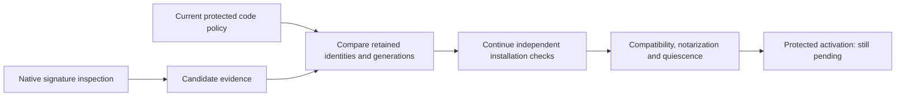

# Retained release generation checks

`ReleaseGenerationPreflight.validate` compares native candidate signature evidence with retained code policy.
It checks identity and generation for present roles, including disabled roles.
Every active retained role must remain present.
An absent inactive role retains its policy entry and floor.

The candidate generation must meet both the retained minimum and installed generation.
A signed older build cannot pass merely because its generation exceeds the minimum.
A new build may retain its security generation and have a different CDHash.
The native reader still verifies its actual signature and declared component hashes.

Newly bundled roles gain no active policy entry through this check.
Missing active roles fail before activation; disabling a role needs the separate authorized policy path.
The check does not change retained policy, commit a proposed floor, freeze admission or stop work.

## Installation boundary

A passing result remains a snapshot, not an installation permit.
The trusted installer must read the current protected policy and revalidate protected copies.
The [compatibility comparison](macos-release-compatibility-preflight.md) checks retained formats and request semantics.
The owner must also establish notarization, quiescence and activation health.
Policy revision changes and interrupted activation need their own serialized durable transaction.
Neither a candidate's declarations nor this pure comparison authorize those effects.

This implements the generation comparison from section 17 of the accepted plan.
It does not prove protected placement, service registration or update continuity.
Tests cover retained identities, active and inactive roles, downgrade rejection, signature evidence consistency and no policy changes.
