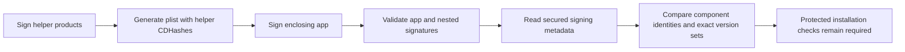

# Signed Mac release declarations

The app contains a canonical CBOR declaration in its signed `Info.plist`.
The key is `RemozioReleaseManifest` and the schema is 1.
The build generates the plist input after signing the six helpers, before signing the app.
It does not modify a processed plist or an existing signature.

## Declaration fields

The root map has these exact keys. Unknown or missing keys fail closed.

| Key | Value |
| --- | --- |
| 0 | Schema 1 |
| 1 | Marketing release |
| 2 | App build |
| 3 | `arm64` |
| 4 | Minimum macOS `26.0` |
| 5 | Components sorted by stable `AuthorityCodeRole` |

Each component has a role, identifier, generation, relative executable path, build, Team ID, formats, and understood request contracts.
The helper CDHash is 20 bytes. The app has no embedded self hash; inspection derives it from the validated signature.
Ad-hoc builds have no Team ID. They are test artifacts.
Component key 9 is zero: this bundle contains no launchd registration declarations.
A later schema must describe actual registration artifacts before an installer relies on them.

The current bundle contains the app, authority, transport, frontend, gateway, command child, and command monitor.
`absentRoles` reports the other catalog roles. It does not imply that every optional role must run.
Compiled library support does not make a GUI adapter, setup controller, tunnel, or bridge executable present.

Each format declares separate, exact reader and writer sets, plus explicit migration edges.
A set such as `{2, 5}` does not include versions 3 or 4.
Storage migration declarations do not authorize migration or erase retained generation floors.
The journal accepts schemas 12 through 16. Its explicit legacy migration maps schemas 1 through 11 to 12.
Optional protected installation still controls later schema changes.

Request contracts declare the kind, wire version, capture schema, action tags, and signature purposes.
The current command contracts use wire 1 and capture schemas 1, 2, and 3.
They understand decline and execute. Execute still requires biometric authorization against the retained request.
These declarations do not enable command mode or invent active 1Password or Little Snitch adapters.

Arrays are sorted and unique. Identifiers, roles, paths, contracts, and format names cannot repeat.
The decoder has a 64 KiB ceiling, depth 8, and 8,192-item ceiling.
It rejects an unsupported schema, unknown purpose, malformed hash, unsafe relative path, or noncanonical declaration.
Decoding alone does not authenticate the release.

## Signature inspection

`SignedReleaseInspection.inspect` requires a trusted Team ID and expected app identifier.
It verifies the Developer ID requirement, hardened runtime, entitlements, all architectures, and nested code through public Security APIs.
Only the application and Team ID entitlements may be present.
Their values must match the trusted Team ID and component identifier.
A production application identifier uses `<TeamID>.<BundleID>`; a team entitlement must match the same trusted Team ID.
[Apple documents this identity prefix](https://developer.apple.com/documentation/security/sharing-access-to-keychain-items-among-a-collection-of-apps).
An ad-hoc fixture cannot claim a production Team ID. Unknown entitlements remain rejected.

It reads `kSecCodeInfoPList`, the secured dictionary from signing information.
It does not use `Bundle.infoDictionary` as authenticated metadata or request private signing-information flags.

Inspection compares each helper's actual signed identifier, Team ID, generation, build, and CDHash with the declaration.
A bounded filesystem inventory must match the declared executable paths exactly.
It detects Mach-O files anywhere in the bundle, including files without an executable mode bit, and executable scripts.
Unlisted code cannot silently appear as an absent role. Schema 1 requires every code file to have a declared native role.
Additional dependency layouts need explicit manifest support before updater or bridge integration.
The inventory permits aliases to plain internal resources. Aliases exposing code count as executable locations too.
Schema 1 requires declared code paths without symlinks. Later dependency layouts must declare their code and alias relationships explicitly.
The inventory rejects external links and special files, and limits traversal to 8,192 entries and depth 16.
It rejects symlinks within the declared executable paths and requires thin arm64 executables.
It rechecks the enclosing signature and declaration before returning candidate evidence.

This evidence is a candidate snapshot. It is not an execution permit or durable activation record.
The protected installer must copy and revalidate the components, enforce retained identity and generation floors, verify notarization, and check compatibility.
The installer must also preserve enrollment and unresolved outcomes, and require the update activation conditions.
The [retained generation preflight](macos-release-generation-preflight.md) compares candidate evidence with retained identities and generations.
It does not perform installation or commit floors.
This change enables no installation, service registration, automatic update, or privileged execution.

## Verification and limits

The repository gate builds both Debug and Release before the Core tests inspect the real artifacts.
Focused tests check canonical schema handling, exact sets, compiled command versions, missing roles, and ad-hoc rejection by the production API.
Artifact tests detect plist tampering, helper tampering, a re-signed helper whose CDHash no longer matches the manifest, and validly signed bundles containing unlisted helpers or scripts.
The re-signing test uses only disposable copies and ad-hoc signatures.

Standalone Core tests skip artifact cases when the app has not been built.
The build check requires a bounded declaration and app generation metadata, so the full repository gate cannot silently use an old bundle.
Developer ID distribution, notarization, protected installation, installed process continuity, and update activation remain unproven platform gates.
