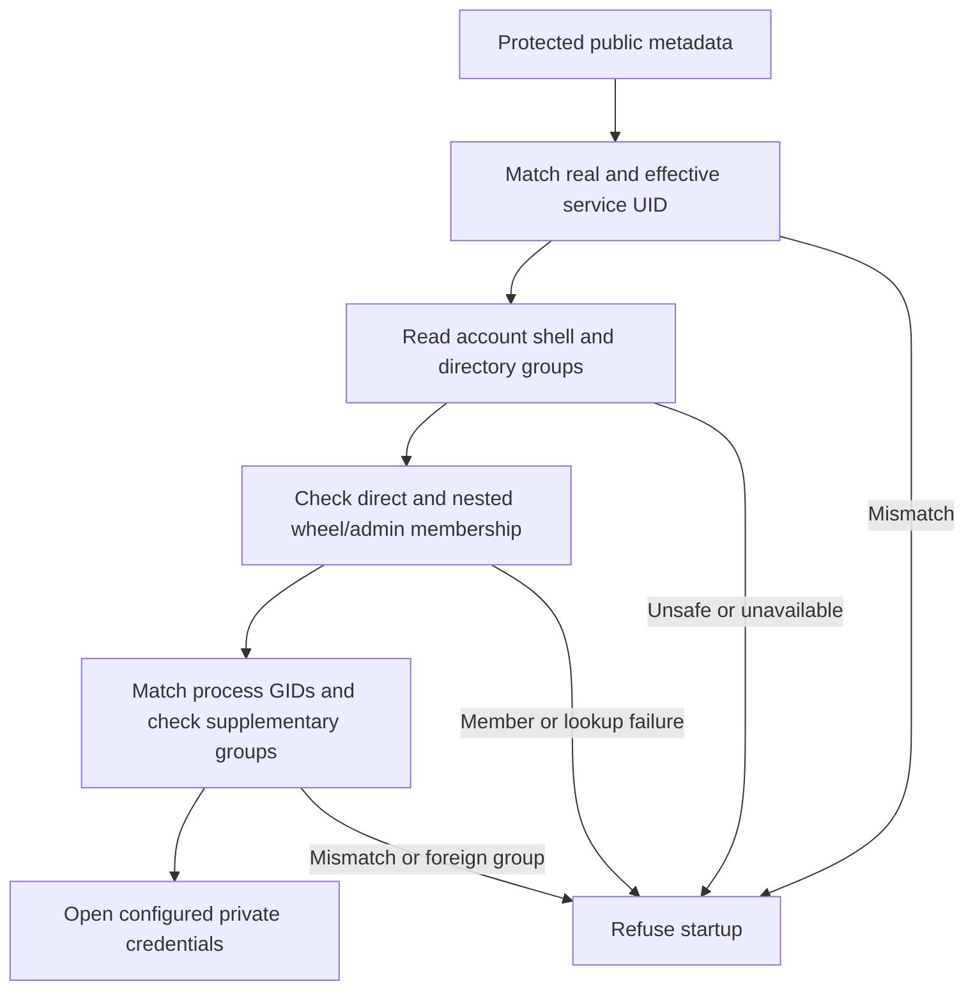

# Dedicated service startup

Transport and push startup must check more than two matching UIDs.
A configured UID can still belong to an interactive account or inherit administrative groups.
The native loaders now inspect the directory account and current process before opening private credentials.

## Startup contract

The service UID must differ from Root and the configured interactive owner.
Its primary GID must be nonzero and valid.
Its login shell must be `/usr/bin/false` or `/sbin/nologin`.
Directory groups must include its primary GID and exclude wheel, admin and invalid IDs.
Native membership queries also reject indirect membership in the named wheel and admin groups.
Unavailable membership information refuses startup; it never becomes an assumed negative result.

Both process UIDs must match the configured service UID.
Both process GIDs must match the directory primary GID.
Supplementary process groups must belong to the directory group set and contain no administrative or invalid IDs.
An empty supplementary set is valid when both primary GIDs match.
The process need not repeat its primary GID in that set.

Directory and process queries permit at most 1,024 groups and never truncate an oversized result.
Private credential reads occur after these checks.
The check applies to direct transport, remote transport, wake startup, standalone wake signing and push startup.
Direct native identity and provider credential loaders also check it, even when a caller constructed configuration in memory.
Failures retain the existing typed `wrongAccount` result and redacted startup messages.
Pure configuration decoding and injected credential fixtures do not authenticate native provisioning.

## Evidence and remaining work

Tests cover nonlogin shells, owner separation, both UID/GID pairs, supplementary groups, nested administrative membership and lookup failures.
Native refusal controls use only the current ordinary process.
They create no account, credential, key or service.

This component does not prove that a UID belongs exclusively to Remozio.
Protected setup must create and record dedicated identities, prevent alternate login and protect all service files.
Provisioning must install the selected nonlogin shell and correct launchd credentials before startup.
Successful installed-account startup, restart, pre-login availability and private credential access remain interactive platform gates.
A later administrator account change cannot be prevented by a startup observation.
No production service is installed or activated by these checks.
