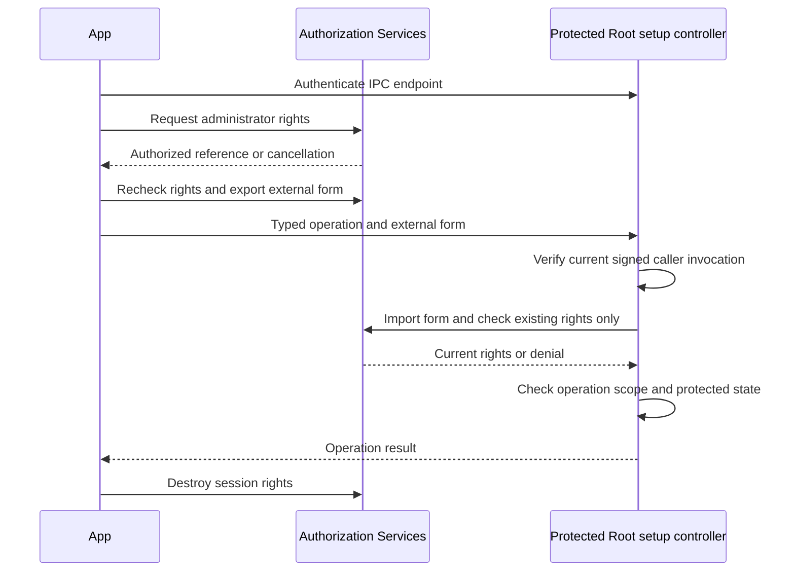

# Administrator authorization for Mac setup

`SetupAdministratorSession` owns one local Authorization Services reference.
The app creates it as an ordinary account and requests administrator authorization away from its UI executor.
macOS collects credentials. Remozio receives no password.

The native gate uses `system.privilege.admin`. It never changes the authorization database.
It accepts only a user-class rule with authenticated administrator membership, no session-owner shortcut, no shared rights and a positive timeout up to 300 seconds.
A different managed policy reports failure. The app must explain this condition; it must not replace the policy.
A zero timeout is incompatible with this existing-rights-only flow. It fails before the client requests a prompt.
A shorter positive timeout remains subject to the native rights check. No successful operation is promised from policy metadata alone.

The client may allow interaction and extend its rights only when the user requests authorization.
Export checks current rights without interaction or extension.
The Root gate first verifies the current XPC invocation and a non-Root caller.
It then imports the exact platform external form and checks existing rights without interaction, extension, partial rights or preauthorization.
It rechecks the policy after that check.

External forms are bearer credentials. They must travel only through an authenticated setup connection after the harmless handshake.
Do not log, persist, export or route them through the phone transport.
Keep the client session alive until the typed operation finishes. Close it afterwards to destroy its rights.
Cancellation remains distinct from denial. Session objects reject use after closure, credential changes or a fork.

This gate supplies administrator authorization, not a one-use operation permit.
The setup controller must independently bind the operation to its authenticated caller, requested scope and retained state.
It must recheck authorization immediately before a privileged operation.
It must also enforce freshness and idempotent recovery before any write.
Authorization alone creates no phone enrollment, account, command grant, file, service or network listener.

Six focused controls cover relaxed policy rejection, malformed forms, native uncredentialled references, unavailable exports, closure, ordinary-caller refusal and cancellation.
Omitting the helper rights check makes the native refusal control fail. Restoring it makes the complete focused suite pass.
The tests request no administrator rights and open no authentication prompt.
They prove refusal under the measured local policy, not successful administrator authorization or Root importer behavior.

The product app still needs the setup controller, protected bootstrap placement, typed IPC and operation composition.
Interactive tests must cover real authorization and cancellation, expiry, session destruction, the Root importer and managed-policy failure.
They must also verify that one setup operation does not authorize an unrelated later operation.

Sources: [Authorization Services external forms](https://developer.apple.com/documentation/security/authorizationmakeexternalform(_:_:)) and [AuthorizationCopyRights](https://developer.apple.com/documentation/security/authorizationcopyrights(_:_:_:_:_:)).
