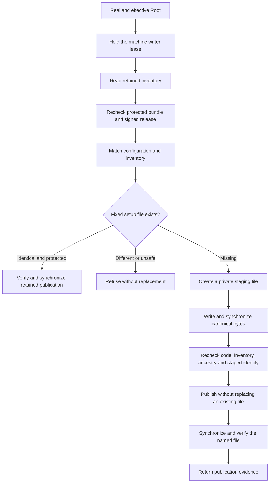

# Protected setup configuration publication

The installer needs the fixed private setup file before the bundled host can start.
`AdministrativeSetupPublication.publish` now provides that publication step.
It requires an existing machine store and grants no installation, enrollment or execution authority.

Production publishes only `AdministrativeSetupConfiguration.startupPath`.
It holds the existing machine writer lease throughout the operation.
It compares the configuration with retained installation identity and fresh signed release evidence.
The protected bundle lease remains open and is rechecked before and after publication.

The file has private permissions and empty access-control entries.
An identical existing file is opened through the retained directory descriptor.
Its content, identity and metadata are checked before and after file synchronization.
The directory is also synchronized without changing the file bytes or identity.
A conflicting file, link or unsafe permission stops publication.
There is no overwrite or configuration-reset path.

The staging file must retain its descriptor identity, canonical content and metadata.
Publication uses exclusive rename. A competing destination is never replaced.
Cleanup removes only a staging name that still denotes the owned file.
A failure after rename can leave the correct file in place.
A later matching call verifies and synchronizes that publication without recreating it.

The result is file-publication evidence. It does not prove service registration, administrator consent or runtime health.
Machine initialization, explicit enrollment, hardware keys, installer invocation and installed service checks remain unfinished.

Eight controls use actual ordinary-owner files.
They cover private publication, immutable replay, conflicts, links, permissions, changed directories, modified staging files and lost acknowledgment.
The public entry point also rejects an ordinary user before reading or writing protected paths.
These fixtures do not prove Root behavior, power-loss durability or Developer ID installation.
