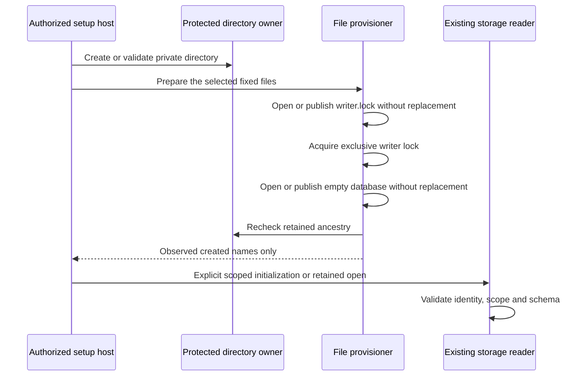

# Database files for protected setup

`SetupDatabaseFileProvisioning.prepare` creates the fixed files required by the existing Root storage readers.
Both process identities must be Root before directory creation or file access.
The setup host separately establishes administrator authorization, trusted code placement and the operation scope.

| Kind | Database file | Writer lock |
| --- | --- | --- |
| Journal | journal.sqlite | writer.lock |
| Continuity | continuity.sqlite | writer.lock |
| Installation | installation.sqlite | writer.lock |

New files use mode 0600 under a private directory.
Only a new empty staging file receives ACL and mode normalization.
The native no-replace rename cannot overwrite a competing destination, including an empty file.
A busy runtime writer prevents database creation.
Existing bytes, modes and inode identities remain unchanged. Unsafe metadata, aliases and non-regular objects cause refusal.
The path budget includes the database basename used by the runtime loader.

The provisioner opens no database and reads no database contents.
Its result grants no initialization, repair, enrollment or execution authority.
In particular, a newly created file does not prove a fresh installation.
The setup host must validate its retained setup intent and scope before initializing an empty store.
Do not call this API from ordinary startup or use initialization as recovery.
The journal and independent continuity directories must remain distinct; their storage composition still checks that boundary.

An interrupted publication can reopen the retained file without replacing it.
A prepared interruption can leave an empty staging file. A separate retry preserves that remnant and creates the missing final file.
Synchronization is implemented, but these controls do not certify power-loss behavior.

Fifteen ordinary-owner controls exercise actual journal and installation-store initialization, retained reopen, continuity lease acquisition, writer exclusion, byte preservation, aliases, FIFOs, path budgets and publication faults.
The empty-destination control fails when native no-replace protection is removed and passes after restoration.
The combined file and directory suite passes 32 controls. No Root state or production keys were created.

The product administrative controller still needs to compose file provisioning with its durable setup intent and explicit scoped initialization.
Account creation, configuration publication, service registration and the first physical Mac–Pixel flow remain incomplete.
