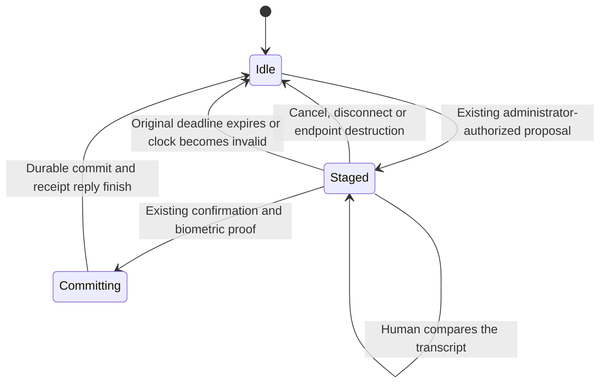

# Setup and pairing release activity

The installed setup host and Root pairing endpoint participate in the existing machine activity barrier.
This prevents their active operations from appearing idle to a future installer.
It does not enable update activation.

## Administrative setup

```mermaid
sequenceDiagram
    participant App
    participant Setup as Installed setup host
    participant Activity as Machine activity file
    participant Store as Machine writer
    App->>Setup: Existing authenticated setup operation
    Setup->>Activity: Acquire shared activity
    Setup->>Store: Open and verify current installation
    Setup->>Store: Prepare or inspect account state
    Setup->>Store: Close writer
    opt Explicit service activation
        Setup->>Setup: Register exact retained jobs
        Note over Setup,Store: Writer scopes reopen for verification; activity stays held
    end
    Setup-->>App: Existing result or failure
    Setup->>Activity: Close activity after the reply callback finishes
```

Startup retains shared activity while it validates the protected release and constructs the setup owner.
Idle setup owners retain no shared lock and no machine writer.
Every scoped operation acquires activity before opening its writer.
The native endpoint retains another reference through authorization, response encoding, and the reply callback.
Service activation retains activity across both writer scopes and native registration between them.
An exclusive owner refuses new setup work before the writer opens. A later explicit retry uses fresh state.
Failures release activity without replaying an operation or changing committed progress.

## Root pairing lifetime



Each staged attempt retains an independent shared reference.
Cancelling one connection cannot release another connection's reference.
Each pairing invocation also retains activity through its reply, including commit after the staged reference closes.
A lost reply still requires receipt reconciliation. Activity cleanup cannot undo an enrollment or authorize another commit.

A bounded timer checks the existing continuous authority clock once per second while an attempt remains staged.
Expiry uses the original monotonic deadline, including elapsed time during sleep. It does not extend the transcript or enrollment lifetime.
The timer discards only uncommitted Root setup state. It creates no enrollment, receipt, or automatic retry.
Commit continues to check its own deadline before and after its durable operation.

The pairing access reads the journal's current barrier at invocation time.
This preserves installed startup order: pairing access can be constructed before command registration attaches the machine barrier.

## Evidence and remaining work

Ordinary-owner tests cover idle setup, exclusive refusal, failure cleanup, changed metadata, and both service registration scopes.
Pairing tests cover independent attempts, reply ownership, cancellation, destruction, timer expiry, invalid clock progress, and late barrier attachment.
The existing enrollment, administrator, proof, receipt and checkpoint tests remain required.
These controls use fixture identities and logical registration. They do not establish installed Root behavior or native administrator consent.

No new authorization prompt, biometric operation, pairing reset, automatic drain, or command limit is introduced.
The app, transport, gateway, GUI permits and other role work still need complete coordinated quiescence.
The protected installer still needs activation, compatibility checks, one durable floor commit, and crash recovery before automatic replacement can be enabled.
Candidate services also need a verified activation-specific startup and health path while ordinary admission remains closed.
An exclusive owner currently blocks ordinary shared startup; releasing exclusion before the final checks cannot substitute for that path.
See [authority activity](macos-authority-release-activity.md) for the protected file and native command cleanup boundary.
