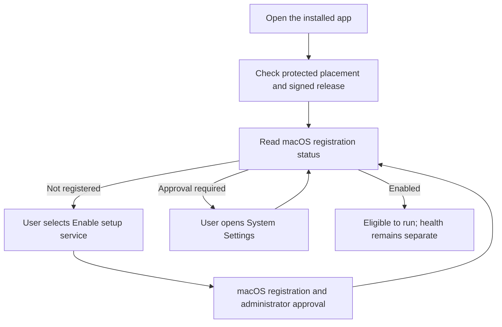

# Mac setup service controls

The app replaces its setup placeholder with an explicit setup-service control.
The user enables only the bundled Root setup helper.
macOS retains control over registration and administrator approval.
This step does not register the approval service or grant command access.

## Registration boundary

Only the fixed `dev.remozio.setup.plist` declaration is selectable.
The app must run from the protected package destination as an ordinary account.
The Applications shortcut can resolve to that destination.
The native Security API reports the running GUI app as its bundle.
The location check accepts that bundle or its exact main executable, then validates the current signature.
Development copies show package installation guidance and do not query registration status.

The running app supplies its native code identity.
The controller validates that identity and compares it with the complete signed release on disk.
It checks the setup executable path and exact bundled launch declaration.
A read-only placement lease retains Root-owned ancestry through the framework call.
The controller checks placement and signing again before reporting its result.

The ordinary reader creates no file, lock, account or protected state.
The public write entry point still requires real and effective Root identity.
This reader grants no installation, activation, generation-floor or update-quiescence authority.
The setup host retains all independent startup and invocation checks.

The controller runs filesystem and signing checks outside the UI executor.
It serializes inspection and registration and disables repeated actions while work is pending.
Opening the app only reads status.
Registration and opening System Settings each require an explicit user action.
An error after registration triggers a fresh status read, never another registration attempt.
It does not unregister or undo an uncertain result.
A fresh enabled or approval-required result is expected progress, even if registration threw.
An absent or unavailable registration retains its failure notice.

## Visible states

| State | App behavior |
| --- | --- |
| Package required | Explain how to open the installed app. |
| Not registered | Offer Enable setup service and explain administrator approval. |
| Approval required | Offer System Settings and retain the pending state. |
| Enabled | Report macOS permission to run; do not claim runtime health. |
| Not found | Explain package reinstallation. |
| Unavailable | Show a refresh action and any current operation error. |

Returning from System Settings refreshes status.
Refreshing never grants access or repeats registration.
The existing pairing and setup-file controls remain available.

## Evidence and remaining work

Twenty-six focused tests cover these controls.
Fourteen cover the setup controller and code-location checks, including pending approval, failures, lost replies and overlapping actions.
The native test process receives package guidance without registration.
Two new placement tests inspect existing Root-owned metadata as an ordinary account and retain the Root-only write refusal.
They create no system state.

These controls do not prove actual installed daemon registration or administrator approval.
The [installed-service gate](https://github.com/rock3r/remozio/issues/363) remains open.
The [Root coexistence gate](https://github.com/rock3r/remozio/issues/374) also remains open.
Account enrollment, role provisioning, keys, grants and runtime configuration remain on the first approval-flow path.
