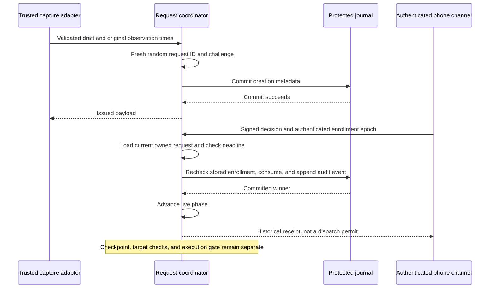

# Approval request owner

`ApprovalRequestCoordinator` owns live request state for one Mac/account. A signed phone decision selects an owned request by ID. It cannot supply the retained payload, phase, deadline, or trust snapshot.



## Service contract

The coordinator is non-Sendable. The root service must keep the coordinator and its journal on one executor.
That executor must serialize admission, adapter observations, enrollment changes, routing, consumption, and outcome recording.
A second journal caller must not consume or transition these requests.

The host must establish protected writer ownership, authority continuity, startup recovery, and admission storage reserves before constructing the coordinator.
The coordinator does not establish these requirements. Its memory limits and ledger count limit reserve no disk space. They do not guarantee storage for a complete request lifecycle.

The coordinator accepts drafts only from a trusted adapter that has checked capture semantics and target identity.
A decoded remote submission is not a validated draft.
The owner uses the journal's Mac/account identity and generates random IDs and challenges. It preserves the draft's original observation times.

The caller must supply time from the configured authority clock, which includes sleep. Phone messages cannot supply authority time.

Before consuming a phone decision, the service must recheck the target within the same serialization boundary.
It must retire a request with a known timeout or disappearance before consumption.

The channel supplies its authenticated phone identity and enrollment epoch independently of the decision bytes.
The owner checks both values against current durable enrollment within the consumption transaction.

The owner creates no audit event for an invalid signature, unknown request, or wrong channel.
Rejection aggregation and rate limits remain unimplemented.
The owner uses the existing journal for creation, pending retirement, consumption, and post-consumption outcomes.

## State and capture lifetime

Admission publishes the payload only after the journal commits creation metadata. A failed write publishes no provisional in-memory entry.
Consumption and outcome recording update memory only after their journal transaction succeeds.
A failed retirement keeps the previous state and reports an error. It cannot claim an unrecorded result.

`pendingRequest` returns only a current queued or presented request.
It checks the storage lease and expires a request whose authorization deadline has elapsed before returning.
Repeated `markPresented` calls have the same effect as one call. Dismissing a phone sheet neither retires nor changes the request.

`consumedRequest` retains the original binding while the phase is Authorized or Executing.
The executor uses this data for its separate target and checkpoint checks. The data grants no dispatch permission.
Expiry cannot rewrite an already consumed action.

Terminal transitions release the coordinator's capture reference. The host must also release copies held by adapters or transport queues.

`state` returns locally observed metadata with a positive revision that a status payload can use.
It retains the reason, terminal time, deciding phone, and request bindings after capture release.
Reconciliation can construct status without a separate retained outcome description.

Terminal time stays fixed. The wire terminal age equals terminal time minus first-observed time, so it measures time until completion.
The metadata carries no signature and cannot establish freshness.

The host must:

- Evaluate deadlines even without phone traffic.
- Reconcile terminal state with all devices and withdraw queued work.
- Call `reconcileDelivery` after every owner transition and before transport work.
- Apply its withdrawals to queued tasks and started retry tasks before discarding a closed delivery owner.
- Call `reconcileDelivery` before `forgetTerminal`, because reconciliation cannot find forgotten requests.

`reconcileDelivery` reads current owner state, commits elapsed expiry, and closes deliveries after capture release.

The host must stop affected delivery tasks after a storage or clock error. These errors prohibit transport work.

The host must prepare asynchronous resources before calling `handoffDelivery`.
It must call this method within the root owner's serialization boundary before the first transport write.
The method rereads current owner state and protected journal trust, then calls the synchronous transport callback.

For a resolved request, the method returns withdrawals from retained metadata, even after capture release.
It must commit elapsed expiry before returning those withdrawals.
A storage or clock failure prevents the callback from running. A stale caller snapshot cannot replace the current read.

```mermaid
sequenceDiagram
    participant Host as Serialized root host
    participant Owner as Request coordinator
    participant Store as Protected journal
    participant Transport as Prepared local transport
    Host->>Owner: Handoff queued identity with fresh presence and time
    Owner->>Store: Check lease, current enrollment, and expiry commit
    alt Resolved, expired, or revoked
        Owner-->>Host: No handoff; apply withdrawals
    else Current and routed to phones
        Owner->>Transport: Synchronously accept exact delivery identity
        alt Backpressure; nothing accepted
            Transport-->>Owner: False
            Owner-->>Host: Keep queued with original deadline
        else Ownership accepted
            Transport-->>Owner: True
            Owner-->>Host: Mark first handoff complete
        end
    end
```

The callback must not await, reenter either owner, or mutate authority state.
It must return false only when it has accepted no bytes or work.
After accepting ownership, it must return true even if delivery later fails.

The host can retry a refused handoff with the original identity and deadline.
An accepted identity cannot start another first handoff.
The receiving queue owns bounded retries. The host must send subsequent withdrawals and routing changes to that queue.

The host must apply every returned update, including when `delivery` is nil.
Queue acceptance proves neither provider acceptance nor phone receipt. It grants no action authorization.
`handoffDelivery` does not install an interprocess communication (IPC) endpoint or invoke the asynchronous gateway actor.
The host must still validate the target.

`ApprovalRequestState.statusPayload` preserves the v1 wire contract.
It maps internal Unknown with target disappearance to Cancelled/target-disappeared.
Existing phones display this as “No longer available · reason unknown.” The owner's state remains Unknown.

The host supplies a separate increasing observation revision, the original observation ID, and current authority time. It then authenticates the response.
The host must not reuse a lifecycle revision for a changed time sample.
A different wire form requires capability or schema negotiation.

The configured request count includes terminal metadata until `forgetTerminal` removes it.
The capture byte limit includes Authorized and Executing requests until they reach a terminal outcome.
Forgetting cannot remove a live request or its durable consumption receipt. Every new admission creates a new ID and challenge.

## Unknown, expiry, and restart

Pending retirement uses distinct reasons:

| Observation | Result |
| --- | --- |
| Local request cancellation | Cancelled; no target action |
| Authorization deadline has elapsed | Expired; the owner verifies the deadline |
| Adapter establishes an actual target timeout | Expired with target-timeout metadata |
| Target disappears without an established result | Unknown with target-disappearance metadata |
| Authority restarts before consumption | Cancelled; fresh submission or recapture required |

A 1Password expiry estimate does not establish an observed timeout.
The shared `loseTarget` transition permits Unknown only for queued or presented requests.
Consumed actions use the existing outcome transitions. Unknown stays terminal even if evidence arrives later.

A clock regression or epoch change retires the live coordinator and releases its captures.
The host closes delivery and follows the normal recovery path. Closed storage blocks live snapshots.
Errors do not authenticate a no-admission result. They must never trigger automatic action replay.

A new coordinator starts empty. Journal history and old consumption receipts cannot reconstruct a live request or execution binding.
`historicalOutcome` supplies retained evidence of the winning decision for Already handled responses.
Startup recovery must still classify unresolved historical actions. The coordinator neither retries those actions nor invents outcomes.

## Evidence and remaining gates

Sixteen normal-user tests use the real protected journal and disposable P-256 keys.
They cover fresh bindings, metadata privacy, presentation, first-decision ownership, current enrollment, and decline.
They also cover deadlines, target loss, journal failures, outcome retention, memory limits, and restart.

Swift and Kotlin test every lifecycle state/event pair against the same fixture, including pending target loss.
The tests execute no action and use no real credential, provider, or phone.

Production admission or dispatch still requires protected service hosting, authenticated transport, actual adapter validation, and protected checkpoint recovery.
It also requires lifecycle storage reservations, deadline scheduling, and physical-device checks.

## Expiry without phone traffic

`expirePending` scans the bounded live request set using one authority time sample.
It selects queued or presented requests whose deadlines have elapsed. It commits their expiry events in one journal transaction.
Only a successful commit changes live state and releases captures.

A failure on any audit insert leaves the entire selected set unchanged. Authorized and executing requests keep their original state.

The host must run the sweep under `AuthorityJournal.withRequests`.
It must reconcile each returned state with its delivery owner and withdraw queued work.
A failed sweep is an authority error. The host must stop affected delivery work without reporting expiry.

The host must supply its own timer and a clock that includes sleep.
`expirePending` neither installs that timer nor sends a network status message.

Tests cover exact and future deadlines, presented requests, consumed requests, repeated sweeps, and closed storage.
They also check rollback after the second audit insert fails.
