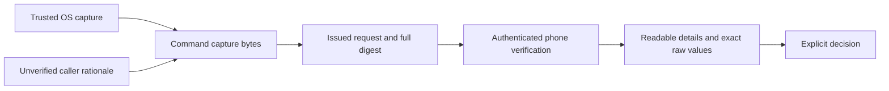

# Command capture schemas 1–4

`CommandCapture` retains the Mac schemas 1–3. `LinuxCommandCapture` implements the
distinct Linux schema 4, allocated in [issue #441](https://github.com/rock3r/remozio/issues/441#issuecomment-6253309933).
All use command kind 0 and approval request wire 1 with no optional features.
Swift and Kotlin retain typed fields and exact canonical bytes. Linux requester
data never passes through the Mac requester or signing model.

The caller supplies the expected schema from the authenticated request contract.
Existing callers default to schema 1.
The inner version must match exactly.
Parsing checks structure but cannot prove that the operating system supplied the capture.

Native adapters now observe the authenticated caller, executable, directory, retained input object, and bounded caller ancestry.
The [retained assembler](../docs/macos-command-capture-assembly.md) combines these observations with the original local submission and trusted policy context.
The Swift producer encodes exact canonical bytes and applies the existing strict parser checks.
Command admission and execution remain integration work.
These codecs do not install or enable a production command handler.

## Root fields

Every map has exactly the documented keys. Optional observations use explicit CBOR null, not omitted fields. Unknown keys, versions, types, and enums fail. All field numbers below are unsigned map keys.

| Key | Field | Type |
| --- | --- | --- |
| 0 | Capture schema | Unsigned `1`, `2`, `3`, or `4`, matching the signed contract |
| 1 | Effective executable | Map below |
| 2 | Complete argv, including argv[0] | Nonempty array of raw byte strings |
| 3 | Working directory | Map below |
| 4 | Target credentials | Map below |
| 5 | Effective environment | Ordered array of entries below |
| 6 | Bound stdin source | Map below |
| 7 | I/O mode | Pipes `0`, PTY `1` |
| 8 | Started-command disconnect behavior | Terminate `0`, continue running `1` |
| 9 | Requester observations | Mac map for schemas 1–3; Linux map for schema 4 |
| 10 | Observed ancestry and limits | Map below |
| 11 | Unverified caller rationale | Text or null |
| 12 | Submission bindings | Map below |
| 13 | Stream layout, schemas 3 and 4 | Map below; schema 4 restrictions apply |

The disconnect field describes an already-started command. It does not add resumable admission, detached approval, or automatic retries. Product defaults and supported I/O combinations belong to the execution adapter.

Schemas 1 and 2 contain exactly fields 0 through 12. Schemas 3 and 4 contain exactly fields 0 through 13. Legacy bytes stay unchanged.

## Paths, argv, environment, and credentials

File identity is `{0: device UInt64, 1: inode UInt64}`. It identifies an observed file, not immutable content. The executable map is `{0: absolute path bytes, 1: file identity, 2: SHA-256 bytes32}`. The directory map is `{0: absolute path bytes, 1: file identity}`.

Paths and argv preserve their raw bytes. Paths start with `/`; all C-string fields reject NUL. Empty arguments, non-UTF-8 bytes, control characters, and distinct Unicode spellings remain intact. No shell quoting, path normalization, or argument splitting occurs in this parser.

Target credentials are `{0: UID32, 1: GID32, 2: ordered supplementary GID32 array, 3: observed user name text|null}`. A missing name does not hide the numeric identity. The service must capture effective credentials from trusted policy and OS state.

Each environment entry is `{0: name bytes, 1: value bytes, 2: source}`. Source is minimal environment `0` or explicit requested addition `1`. Names are nonempty, contain neither NUL nor `=`, and are strictly ordered by unsigned byte lexicographic order. Duplicate names fail. Values can be empty but cannot contain NUL. Capture the complete effective environment, not just a cosmetic change list.

The authority builds the deterministic environment before approval and executes the captured values. This codec does not choose PATH, HOME, locale behavior, or an environment allowlist. Ambient service variables must not be substituted later.

## Input and requester provenance

Stdin is `{0: kind, 1: stream binding16|null, 2: observed absolute path bytes|null, 3: file identity|null}`.

| Kind | Tag | Supported schemas |
| --- | --- | --- |
| Null | 0 | 1, 2, 3, 4 |
| Caller-controlled pipe | 1 | 1, 2, 3, 4 |
| File | 2 | 1, 2, 3, 4 |
| Caller-controlled TTY | 3 | 1, 2, 3, 4 |
| Caller-controlled PTY | 4 | 1, 2, 3, 4 |
| Caller-controlled socket | 5 | 2, 3, 4 |
| Directory | 6 | 2, 3, 4 |
| Caller-controlled device | 7 | 2, 3, 4 |
| Other caller-controlled source | 8 | 2, 3, 4 |

Null input requires all three remaining values to be null. Other kinds require the opaque stream binding. Available path and identity observations remain optional.

Schema 2 keeps all existing fields and tag meanings. Schema 1 rejects tags 5 through 8. Future tags and schemas fail in both parsers. An unavailable classification must use `other`, never a fabricated file or pipe label. A directory label does not promise that reading succeeds.

The authority retains the actual stream behind that binding. A path or stream ID alone cannot open, replace, or authorize an input stream. The phone must disclose that caller-controlled content is not captured or approved byte-for-byte. Streaming remains supported.

## Stream layout in schema 3

Schema 3 binds the three stream observations and terminal routing to the approved bytes.
Field 6 remains the stdin source. It must equal the source in the layout's stdin observation.

| Layout key | Value |
| --- | --- |
| 0 | Stdin observation |
| 1 | Stdout observation |
| 2 | Stderr observation |
| 3 | Original caller terminal observation or null |
| 4 | PTY selection mask, unsigned 0 through 7 |

Each stream observation is `{0: source map, 1: access tag, 2: semantic flag mask}`.
The source map uses the same keys and meanings as field 6.
Access is read-only `0`, write-only `1`, or read/write `2`.
Stdin rejects write-only access. Stdout and stderr reject read-only access.

| Semantic flag | Bit value |
| --- | --- |
| Append | 1 |
| Nonblocking | 2 |
| Asynchronous IO | 4 |
| Synchronous IO | 8 |

The mask ranges from 0 through 15. These are portable meanings, not Darwin flag integers.
The authority observes these flags without changing the caller's shared stream state.
Null sources still carry their access and flags. Their source metadata stays null.

The caller terminal observation is `{0: stream observation, 1: session ID, 2: terminal device}`.
Its source must be a TTY or PTY with a file identity and read/write access.
Its session ID must be positive, at most Int32.max, and equal the requester session ID.
Its terminal device is the kernel's UInt32 device value. `UInt32.max`, the absent-device sentinel, fails.
Paths and labels provide no terminal authority.

The selection mask uses bit 1 for stdin, bit 2 for stdout, and bit 4 for stderr.
Each selected stream must be a TTY or PTY with the caller terminal's file identity.
The execution adapter routes selected streams through the private command terminal.
It preserves each unselected stream's retained source, including files, pipes, and foreign terminals.

Pipes mode requires a zero selection mask and no caller terminal observation.
PTY mode permits every selection mask, including zero when all three streams are redirected.
A missing caller terminal requires a zero mask. It does not prohibit a private command terminal.
The adapter must establish each mapping from authenticated kernel observations, not caller-supplied paths.
It must recheck the original caller, terminal, retained stream identities, and semantic flags before dispatch.

These codecs validate the representation. The [retained layout adapter](../docs/macos-command-stdio-layout.md) implements the separate descriptor carrier and OS rechecks.
The native adapter supports mapped execution. Production frontend integration remains required.
The Android connection advertises schemas 1–4 and shows all three retained stream observations.

## Mac requester observations (schemas 1–3)

Requester fields are:

| Key | Value |
| --- | --- |
| 0 | Observed absolute executable path bytes |
| 1, 2 | Real UID32 and effective UID32 |
| 3, 4 | Positive PID up to Int32.max and PID-version UInt32 |
| 5 | Signing observations below |
| 6 | Session ID UInt32 or null |
| 7 | Observed absolute TTY path bytes or null |

Signing observations are `{0: status, 1: identifier text|null, 2: team text|null, 3: cdhash bytes20|null}`. Status is unsigned `0`, ad-hoc `1`, validated `2`, invalid `3`, or unavailable `4`. Available descriptive fields do not override status. Never show invalid, ad-hoc, or unavailable observations as a verified publisher. Null metadata must remain visibly unavailable.

Ancestry is `{0: completeness, 1: ordered entries, 2: reason}`. Completeness is complete `0`, partial `1`, or unavailable `2`. Reason is none `0`, process exited `1`, permission `2`, truncated `3`, or unsupported `4`. Complete requires reason none; partial and unavailable require a limitation reason. Unavailable requires no entries.

Each ancestor is `{0: positive PID up to Int32.max, 1: PID-version UInt32, 2: absolute executable path bytes|null, 3: UID32}`. Entries run from the immediate parent outward. The UID is the observed effective UID. They describe observations at submission time. Neither a complete chain nor an authenticated frontend proves which person or AI model initiated the command.

Submission bindings are `{0: ID16, 1: nonce32, 2: caller-channel binding16}`. They are opaque bytes. The service must associate them with its verified IPC peer and retained caller/session lifetime. A supplied identifier is not proof of that association.

## Linux requester and execution shape (schema 4)

Root fields 1–8 and 11–13 preserve their existing encodings and meanings, with
the restrictions below. Root 9 is a closed map with exactly these mandatory keys:

| Key | Value |
| --- | --- |
| 0 | Exact text `linux-protected-single-thread-v1` |
| 1 | Observed PID, positive UInt32 at most Int32.max; presentation only |
| 2 | Authority-assigned process binding, bytes16 |
| 3 | Monitor incarnation, bytes16 |
| 4 | Positive exec epoch, full UInt64 including UInt64.max |
| 5 | Frontend executable triple: raw absolute path, device/inode, SHA-256 |
| 6 | Closed Linux credential map below |
| 7 | Observed session ID, positive UInt32 at most Int32.max, or explicit null |
| 8 | Protected frontend/loader admission policy digest, bytes32 |

The credential map has exactly keys 0–8. Keys 0, 1, 2 and 3 hold real, effective,
saved and filesystem UIDs respectively; keys 4, 5, 6 and 7 hold the corresponding
GIDs. Every ID is UInt32. Key 8 is a strictly increasing, unique supplementary GID
array; empty is valid. Keys 0–3 must be equal and keys 4–7 must be equal. UID need
not equal GID. The host must separately establish unchanged credentials throughout
admission. Unknown profiles, missing/extra nested keys and out-of-range values fail.

Root 10 must be exactly `{0: 2, 1: [], 2: 4}`: unavailable ancestry with no entries
and reason unsupported. Root 7 must be pipes `0`, root 8 must be terminate `0`,
layout terminal must be null and the PTY mask must be zero. Root 6 must equal the
layout stdin source. Existing access and semantic-flag rules apply to all three
streams. A caller-controlled TTY/PTY used as an ordinary retained stream does not
establish private PTY routing. These restrictions do not narrow Mac schemas.

All Linux fields are covered by the capture and issued-request digests. The
process binding names one locally retained process instance within a monitor
incarnation. The exec epoch describes continuously observed exec events; it is
not a PID version or start time. Attempting to advance past UInt64.max retires
the binding and pending requests. Codec acceptance of those values establishes
no kernel lifetime, protected launch, trace ownership or dispatch authority.

Android labels the requester “Linux requester” and the policy “Protected frontend
policy (host assertion)”. It displays the submitting frontend separately from the
requested command, exposes scoped binding/monitor/epoch values and policy digest
in exact details, and keeps ancestry visibly unavailable. No Apple signing fields
or publisher-verification badge are synthesized. A label, schema or digest is not
attestation of the remote OS, TPM custody or protected caller policy.

This contract implements interpretation and phone admission. Production Linux
issuance remains disabled until the separate protected caller, hardware identity,
service and dispatch gates pass. Private PTY routing, continue-running and useful
Linux ancestry require a separately agreed compatible contract.

## Integration rules

Verify the issued request and its exact command/wire/schema contract before selecting this parser. Preserve its bytes in the request digest. Successful parsing must not itself enable an unsupported contract.

The Android command connection advertises implemented schemas 1–4, with no optional features, only alongside their verification, admission and renderer paths. The receiver retains their intersection with the authenticated desktop-host offer. Each new request must use that connection's shared schema. The signed outer schema and inner capture schema must match before inbox admission. Unknown peer contracts remain opaque. Unsupported local advertisements fail. A Mac-only phone remains paired but cannot approve schema 4; other host connections and retained requests remain independent. No display name or unknown feature selects a Linux renderer, and failures never trigger schema translation or fallback.

Existing authenticated request owners survive reconnects. Status messages refer to their retained request digests and do not introduce another capture. A duplicate request still needs a supported contract on the current connection. Direct `open` and `accept` callers keep schema 1 by default.

The producer must choose a contract before encoding the capture. Never relabel a socket, directory, or device to fit schema 1. A peer without schema 2 cannot receive those captures through this handler.

The phone must render every relevant signed value without letting a value create a fake label or row. Make controls, newlines, bidi characters, empty values, and invalid UTF-8 unambiguous. Keep readable details and expandable exact arguments; never replace the signed invocation with a cosmetic shell summary. Rationale must always be labelled unverified.

The authority still must capture the OS values, bind the live caller and streams, recheck the target, and consume the decision durably. Hashes and file identities do not close the measured pathname-execution race. The user accepted [pathname execution after a final recheck](../docs/design-decisions.md#command-execution-by-pathname), including the remaining race and mutable dependencies. Production execution remains unimplemented.

## Evidence and bounds

Schema 1 retains its nine valid and 86 invalid shared fixtures unchanged. Schema 2 adds 13 valid and 16 invalid shared fixtures. Schema 3 adds 39 valid and 75 invalid shared fixtures.

The schema 3 fixtures cover all eight routing masks, all 16 flag combinations, mixed redirects, and malformed nested layouts.
Both languages verify that routing and append-mode changes alter the issued request digest.

Schema 4's [synthetic shared vectors](vectors/command-capture-v4.json) cover the
Linux requester, full unsigned epochs, credential roles/groups, exact ancestry,
pipes-only stream rules and strict nested maps. Requester/stream mutation cases
bind changes to the issued-request digest. These fixtures are not live Linux
caller or phone measurements; existing Mac fixture files remain unchanged.

Both parsers require explicit version selection. Phone tests cover signed version mismatches, disjoint offers, unknown contracts, and schema downgrade after reconnect.

The schema 1 cases cover every input and signing tag, missing observations, unsigned boundaries, nested unknown fields, invalid byte lengths, NULs, relative paths, duplicate/unsorted environment entries, and ancestry consistency. Separate tests cover immutable snapshots, resource bounds, and preservation through the issued-request wrapper.

The caller supplies explicit byte, depth, and item budgets. Nothing is truncated. Test budgets are not product limits; legitimate oversized captures need the design's explicit Request too large result.

Fixtures use invented paths, identities, and metadata. They provide no evidence of OS capture, GUI rendering, caller authentication, or command execution.
