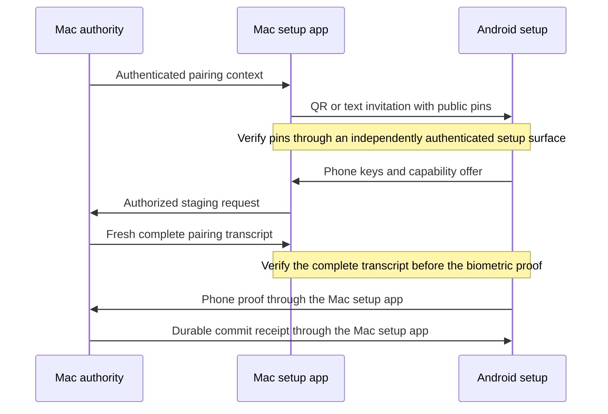

# Pairing invitation version 1

The Mac exports public identity pins after its local Root handshake. QR and pasted text carry the same invitation bytes.
Import does not authenticate a Mac, create a setup attempt, or activate an enrollment.

The diagram describes the required flow. This change implements the invitation format and context export only.
Network setup, QR rendering, scanning, verification UI, and Android activation remain separate work.

## Canonical bytes

Use the existing deterministic CBOR subset. Allow exactly keys 0 through 6, at most 512 bytes, depth 1, and 15 items.

| Key | Value |
| --- | --- |
| 0 | Schema version 1 |
| 1 | Stable 16-byte Mac ID |
| 2 | 16-byte account ID |
| 3 | Display label, 1 through 200 UTF-8 bytes |
| 4 | Mac authority P-256 point |
| 5 | Mac transport P-256 point |
| 6 | Minimum envelope version, greater than zero |

Both points use the 65-byte uncompressed representation. They must be valid and distinct.
The label is display data. It never selects a Mac, account, key, or route.
Reject control characters, directional overrides and isolates, and line separators. Preserve all other UTF-8 bytes without normalization.
Reject an empty label or a label that contains only spaces.

Unknown schema versions, unknown or missing fields, malformed keys, noncanonical encodings, and trailing bytes fail.
An unknown future envelope floor can be displayed or retained. It cannot enable an unsupported protocol version.

## QR and text

Export `remozio-pairing:v1:` followed by the unpadded base64url encoding of the canonical bytes.
The complete text has at most 702 ASCII characters. QR and text imports use the same strict parser.
Reject padding, whitespace, another prefix, non-ASCII payloads, invalid lengths, and nonzero unused base64 bits.
A future UI can trim surrounding paste whitespace before calling the parser. It must not alter the payload.

This text is not a browser URL. Import must never launch a browser, open a connection, accept a request, or activate trust.
The invitation contains no passwords, private keys, key aliases, relay credentials, FCM configuration, or setup authorization.
It contains no network address. Existing address discovery supplies route hints separately; the invitation supplies the expected pins.

## Verification and freshness

The invitation fingerprint uses SHA-256 over this deterministic map:

| Key | Value |
| --- | --- |
| 0 | `dev.remozio.pairing.invitation` |
| 1 | Version 1 |
| 2 | Complete canonical invitation bytes |

The fingerprint input allows 576 bytes, depth 1, and 7 items.
Display all 256 bits as eight uppercase hexadecimal groups of eight characters, separated by hyphens.
This full fingerprint is a protocol diagnostic. It does not select or replace the eventual human verification UI.
Do not truncate it into a short code and claim equivalent authentication.

An invitation fingerprint differs from the complete transcript fingerprint. The complete transcript also binds the phone keys and fresh setup values.
The caller must authenticate the setup surface independently. Comparing two values supplied by the same untrusted message does not authenticate anything.

The invitation has no freshness or enrollment authority. A replay exposes the same public pins and cannot activate trust.
The Root staging owner creates the fresh challenge, setup ID, revision, and elapsed deadline.
The host must verify the complete returned transcript, local administrator authorization, and phone biometric proof before committing.
Android activates its retained PREPARED record only after verifying the authority commit receipt.

`validateMacClaims` checks the transcript Mac/account IDs, both Mac pins, and the exact minimum envelope version against the invitation.
This consistency check does not verify a peer, freshness, phone keys, administrator consent, or a biometric proof.

## Evidence

Shared Swift and Kotlin vectors cover ASCII, Unicode, decomposed text, the maximum label, and a future envelope floor.
Negative vectors cover schema changes, fields, identities, curve points, labels, and noncanonical bytes.
Tests also cover malformed text, nonzero unused base64 bits, fingerprint changes, and mismatched transcript pins or scope.
The Mac context test checks export of the retained public pins. It uses an ordinary fixture and does not prove installed Root pairing.
Physical pairing, hardware biometrics, and the complete Mac–Pixel approval flow remain untested by these checks.
