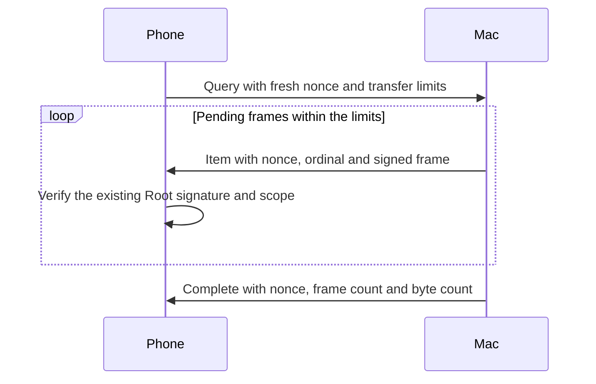

# Bounded pending-request snapshots

Background wake handling needs a finite fetch. The foreground channel streams requests until it closes.
Its EOF or a timeout does not prove that the Mac sent every pending request.

The Swift and Kotlin codecs define a separate enrolled TLS purpose, `remozio-pending/1`.
The purpose is not advertised or handled by the production listeners yet.
Existing `remozio/1` foreground peers keep their existing behavior.

## Transfer

Every message uses the exact domain `dev.remozio.pending.snapshot` and schema version `1`.
The query map has exactly seven fields. Item and completion maps have exactly six fields.
Unknown versions, fields, roles and noncanonical encodings fail closed.

| Key | Query | Item | Complete |
| --- | --- | --- | --- |
| 0 | Domain | Domain | Domain |
| 1 | Schema version | Schema version | Schema version |
| 2 | `0` | `1` | `2` |
| 3 | Fresh 32-byte query nonce | Same nonce | Same nonce |
| 4 | Maximum item count | Ordinal, starting at zero | Actual item count |
| 5 | Maximum frame bytes in total | Opaque existing signed frame | Actual frame bytes in total |
| 6 | Sorted unique retained request IDs | Absent | Absent |

The query can carry up to 4,096 retained request IDs. Each ID has exactly 16 bytes.
The host uses the authenticated authority to refresh their signed statuses, including terminal outcomes.
A caller-supplied ID never grants authority to a status or another account.

Counts include each opaque frame once. They exclude snapshot envelopes.
The query supplies transfer ceilings. The host can enforce stricter configured limits.
The host must close an incomplete transfer if it cannot send the complete set within those limits.
It must not truncate a list and send a completion marker.

The protocol ceilings allow 4,096 items and 64 MiB of frame bytes in total.
One item can contain at most 16,777,088 frame bytes.
The complete snapshot envelope is bounded to 16,777,216 bytes.
The future host adapter must also enforce its configured limits and negotiated channel size.
These ceilings do not allocate memory or select application defaults.

## Receiver

`PendingRequestSnapshotProgress` accepts the exact query bounds and nonce.
It checks each ordinal, total byte count and item count before returning an opaque frame.
A matching completion marker must report the exact totals.
An empty snapshot needs an explicit zero-count marker.
Any malformed frame, mismatch, repeated marker or exceeded limit permanently fails that receiver.
EOF, cancellation and timeout cannot complete it. `requireComplete()` refuses a missing marker.

The caller must verify every returned frame with the existing Root signature, scope and request checks.
Transfer completion grants no decision authority, request freshness or terminal outcome.
Omission from a snapshot cannot expire or dismiss a retained request.
The caller must discard a failed transfer and close its channel without retrying a decision.

## Integration still required

- Admit the new purpose through the existing enrolled TLS pins and current trust checks.
- Enumerate the complete pending set through authenticated authority IPC. Recheck trust around network waits.
- Send compatible signed frames within both peers' limits. Close on an incomplete result.
- Connect the bounded Android worker to retained request owners under the shared enrollment mutex.
- Preserve provider generation checks, cancellation, coalescing and the existing foreground connection owner.
- Validate real background delivery separately from the first foreground Mac–Pixel approval.

Shared vectors cover frame formats and transfer ordering in both languages.
They do not prove network admission, installed services, Firebase delivery or physical-device behavior.
