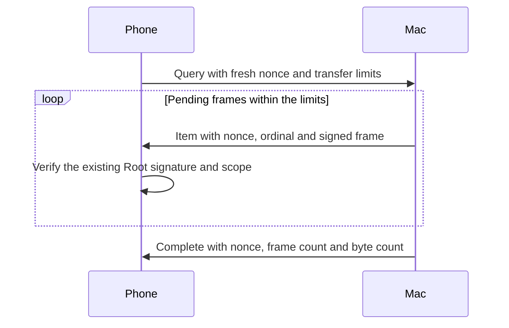

# Bounded pending-request snapshots

Background wake handling needs a finite fetch. The foreground channel streams requests until it closes.
Its EOF or a timeout does not prove that the Mac sent every pending request.

The Swift and Kotlin codecs define a separate enrolled TLS purpose, `remozio-pending/1`.
The Mac listener advertises this purpose and its default dispatcher handles one bounded read-only pass.
The typed Kotlin connector selects it. The phone receiver verifies its frames through the existing request owner.
Android worker and connection scheduling remain separate integration work.
Existing `remozio/1` foreground peers keep their existing behavior.

## Transfer

Every message uses the exact domain `dev.remozio.pending.snapshot` and schema version `1`.
The query map has exactly seven fields. Item and completion maps have exactly six fields.
Unknown versions, fields, roles and noncanonical encodings fail closed.

| Key | Query | Item | Complete |
| --- | --- | --- | --- |
| 0 | Domain | Domain | Domain |
| 1 | Schema version | Schema version | Schema version |
| 2 | `0` | `1` | `2` |
| 3 | Fresh 32-byte query nonce | Same nonce | Same nonce |
| 4 | Maximum item count | Ordinal, starting at zero | Actual item count |
| 5 | Maximum frame bytes in total | Opaque existing signed frame | Actual frame bytes in total |
| 6 | Sorted unique retained request IDs | Absent | Absent |

The query can carry up to 4,096 retained request IDs. Each ID has exactly 16 bytes.
The host uses the authenticated authority to refresh their signed statuses, including terminal outcomes.
A caller-supplied ID never grants authority to a status or another account.

Counts include each opaque frame once. They exclude snapshot envelopes.
The query supplies transfer ceilings. The host can enforce stricter configured limits.
The host must close an incomplete transfer if it cannot send the complete set within those limits.
It must not truncate a list and send a completion marker.

The protocol ceilings allow 4,096 items and 64 MiB of frame bytes in total.
One item can contain at most 16,777,088 frame bytes.
The complete snapshot envelope is bounded to 16,777,216 bytes.
The future host adapter must also enforce its configured limits and negotiated channel size.
These ceilings do not allocate memory or select application defaults.

## Receiver

`PendingRequestSnapshotProgress` accepts the exact query bounds and nonce.
It checks each ordinal, total byte count and item count before returning an opaque frame.
A matching completion marker must report the exact totals.
An empty snapshot needs an explicit zero-count marker.
Any malformed frame, mismatch, repeated marker or exceeded limit permanently fails that receiver.
EOF, cancellation and timeout cannot complete it. `requireComplete()` refuses a missing marker.

The caller must verify every returned frame with the existing Root signature, scope and request checks.
Transfer completion grants no decision authority, request freshness or terminal outcome.
Omission from a snapshot cannot expire or dismiss a retained request.
The caller discards failed transfer bookkeeping and closes its channel without retrying a decision.
It keeps individually verified request and status updates. An incomplete set does not undo a verified terminal status.

## Mac handler

The handler requires the snapshot TLS purpose, matching enrolled scope and a common request contract.
It validates the current authority session before discovery and around every network write.
One authority index defines the pass. New requests need another query with a fresh nonce.
The handler sends every indexed compatible capture, then signed statuses for delivered and retained request IDs.
A missing indexed capture closes the channel without a completion marker.
The listener reserves outer framing and retained-query space separately from the unchanged signed-frame limit.
A missing status grants no terminal outcome. Unknown status remains unknown.
Unsupported captures, exceeded limits or a failed write close the channel without a completion marker.
The local delivery timeout bounds the entire exchange. Snapshot input cannot submit a decision.

The native handler controls use an ordinary process and a mocked authority channel.
Separate native/JVM controls establish the new TLS purpose, enrolled scope and encrypted bytes directly and through an opaque loopback relay.
Their synthetic echo does not establish a Root snapshot or an installed Mac–Pixel exchange.

## Phone receiver

`CommandSnapshotReceiver` requires this TLS purpose and the existing enrolled scope and request contracts.
It makes one query with a fresh nonce and the retained request IDs.
Callers create the connector with `CommandSnapshotReceiver.requiredChannelPayloadBytes(limits)`.
That budget includes both the signed approval frame and its outer snapshot frame.
It also holds the largest retained-ID query, even when the configured body limit is smaller.
Using the ordinary foreground budget cannot hold the configured maximum body and fails binding before sending a query.
The ordinary receiver verifies every returned request and status with the retained Root key.
The channel cannot send a decision. A complete set does not grant action authority.

Background binding claims only an idle receiver. Foreground attachment can replace it and keeps the existing request owners.
Closing or preempting an incomplete snapshot cannot report success.
A capacity omission also fails the fetch. The receiver records that omission before a handoff can reset the UI flag.
Verified terminal updates remain retained when another part of the transfer fails.

## Integration still required

- Coordinate Android foreground and bounded background connection lifetimes with these receivers.
- Connect the bounded Android worker to retained request owners under the shared enrollment mutex.
- Preserve provider generation checks, cancellation and the existing foreground connection owner.
- Retain wake demand that arrives during an active worker. A complete older pass cannot consume that newer demand.
- Validate real background delivery separately from the first foreground Mac–Pixel approval.

Shared vectors cover frame formats and transfer ordering in both languages.
They do not prove network admission, installed services, Firebase delivery or physical-device behavior.
