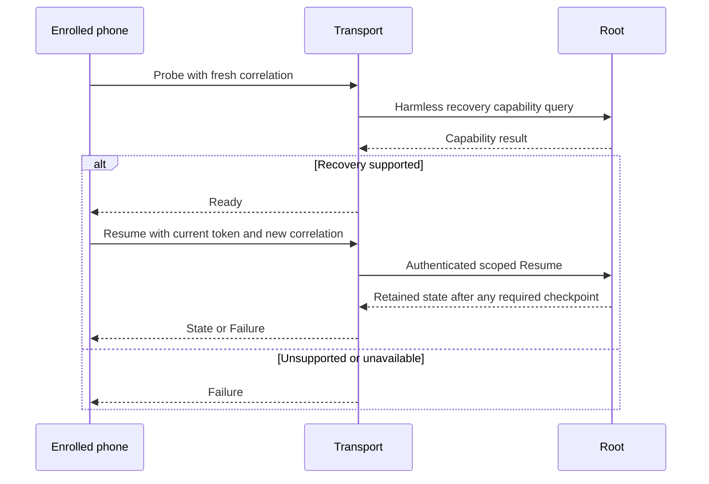
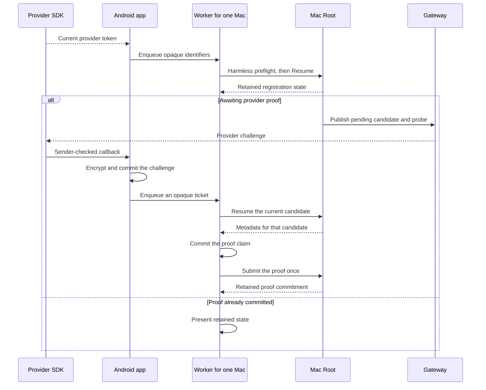

# Phone push registration recovery, draft schema 2

This contract adds an optional recovery exchange to [version 1 registration](phone-push-registration.md).
It connects the shared codecs and Root recovery to optional IPC and enrolled native/phone transport handlers.
The transport performs harmless preflight before accepting a provider token.
The Android app connects private provider ingress, per-Mac registration work and setup status.
Installed services and provider delivery require separate validation.

## Negotiation and compatibility

Negotiate `remozio-push-registration/2` before transmitting a provider token.
Use the current enrolled TLS identity, scope, envelope and replay rules.
Complete a harmless Probe/Ready exchange before the phone sends Resume.
The host must check its optional Root recovery capability before returning Ready.
A transient capability error remains unavailable; it does not prove incompatibility.
Do not advertise approval or audit capabilities.
Keep the version 1 Offer, Prepared, Proof and Outcome bytes unchanged.
Proofs continue through the version 1 purpose.
An uncertain proof result requires Resume; it does not authorize automatic proof replay.
An older peer can reject optional recovery without closing ordinary approval connections.

The existing Root selector `phonePushRegistrationVersion` must continue returning 1.
Old clients require exact equality.
A separate optional recovery selector must establish schema 2 support before sensitive application data arrives.
The codec constant alone establishes no peer capability.
The independent Root selector `phonePushRecoveryVersion` returns 2 only when its handler is configured.
The trust feed uses a separate recovery connection and retires that connection after ambiguous failure.
Ordinary approval and version 1 registration retain their existing connections and version checks.

This diagram shows the implemented source order. Protected Root configuration still controls the optional recovery capability.

## Frame

Use a deterministic CBOR map with exactly keys 0 through 4.
Key 0 is `dev.remozio.phone.push.registration`; key 1 is unsigned 2.
Key 2 selects the role; key 3 is a fresh 16-byte correlation ID; key 4 contains the typed body.
The limits remain 8192 bytes, depth 4 and 64 items.
Reject unknown fields, versions, roles, noncanonical bytes and trailing data.

| Role | Kind | Body |
| --- | --- | --- |
| Probe, phone to host | 6 | null |
| Ready, host to phone | 7 | Unsigned 2 |
| Resume, phone to host | 4 | Existing four-field token offer |
| State, host to phone | 5 | `[metadata, phase, observationAgeMilliseconds]` |
| Failure, host to phone | 3 | Unsigned 0 unavailable, 3 superseded, 4 expired or 5 incompatible |

Schema 2 does not accept the version 1 Offer, Prepared or Proof roles.
A failure cannot claim proof commitment or a confirmed mapping.
All responses must match the request correlation and authenticated enrollment.
Probe and its Ready or Failure response form one exchange.
Resume and its State or Failure response form the next exchange on that connection.
Use a fresh correlation for each exchange.
Ready carries no provider token, enrollment binding or possession proof.
It confirms the recovery contract only; it grants no approval or delivery authority.
The transport handles Probe and Ready. Root receives only the authenticated Resume operation.
An uncertain application exchange cannot trigger automatic route fallback or proof replay.

| Phase | Tag | Observation age |
| --- | --- | --- |
| Awaiting provider proof | 0 | null |
| Proof committed | 1 | null |
| Mapping observed | 2 | Unsigned 0 through 4999 |

Metadata retains its original fourteen fields and excludes the provider challenge.
The historical proof expiry does not expire a committed mapping.
Mapping observed describes a recent gateway observation.
It establishes neither provider delivery nor desktop presence or current connectivity.

## Required runtime semantics

Resume derives scope from the current authenticated enrollment and checks protected provider policy.
A matching current token digest returns retained metadata without minting another candidate.
Only an expired unconsumed candidate can renew for an authenticated resume.
A changed token follows the normal checkpointed preparation path.
No response exposes a provider challenge.

The Root publisher records fresh separately pinned gateway evidence for Mapping observed.
Cached observations bind the Root publication session, trust revision and exact candidate and activation operations.
The Root rejects observations after publisher lease expiry, retirement or changed desired state.
Observation age starts when Root sends the gateway query.
The query deadline also bounds the cache; reply receipt cannot restart that window.
A missing or stale observation returns Proof committed.
The phone must include exchange elapsed time when interpreting the age.
Anchor the validity bound to the local request start; do not restart it when the response arrives.
No clock synchronization is assumed.
The phone result reads elapsed time again when its `state` is consumed.
A delayed read cannot restart freshness or revive an observation that already expired.
A caller must read current state when presenting it and recover again after process restart.

Android joins metadata only with a provider-delivered matching candidate ID and enrollment tag.
Recheck provider generation, token revision and enrollment incarnation after every suspension.
Use a separate attempt handle to reject older replies within one provider generation.
No network suspension may hold either storage lock.
Keep tokens and challenges out of descriptions, logs, notifications, audit and work identifiers.

## Evidence limits

Shared controls cover canonical bytes, hostile roles, schema separation, redaction and bounded observation ages.
Root controls cover idempotent resume, checkpoint failure, lease/session retirement and fresh mapping observations.
The gateway publication fixture uses a real coordinator and journals with software keys and a synthetic provider.
The source now exposes a separate optional Root IPC capability and purpose-bound transport handlers.
Shared controls cover unsupported capability preflight, delayed replies, retirement and unchanged ordinary approval access.
A synthetic native TLS peer exercises Probe/Ready/Resume directly and through the opaque relay.
It supplies fixed state without a configured Root or provider.
The Android lifecycle below connects provider ingress, orchestration and scheduling in source.
[Recorded component results](../docs/experiments/evidence/2026-10-17-phone-push-recovery-components.json) bind the implementation and tests to source commit `cfdaae3`.
The local gate passed 2506 native core tests, with one explicit GUI experiment skipped.
The six required ATC tasks passed 723 test reports, assembly and lint.
The shared recovery fixtures contain eleven valid and thirty-four invalid frames.
Version 1 source and fixtures remain byte-identical to the base.
That earlier record does not exercise the recovery purpose or optional Root IPC.
Codec acceptance cannot authenticate a message or establish actual gateway mapping state.
Installed services, hardware keys, actual FCM delivery and physical Android behavior require separate evidence.

## Transport validation

[The transport record](../docs/experiments/evidence/2026-10-17-phone-push-recovery-transport-components.json) binds the combined implementation and tests to source commit `ad9adfe`.
The full native/Python gate passed 2525 core tests, with one explicit GUI experiment skipped.
The six required ATC tasks passed 738 test reports, APK assembly and lint.
The native TLS peer passed 71 interoperability tests, including recovery directly and through the opaque relay.
It supplied fixed recovery state without a configured Root or provider.

The live unprivileged XPC experiment passed all 53 controls and confirmed temporary service removal.
Those controls include matching peers, hostile peer requirements, and nil and empty recovery replies.
Its ad-hoc identifiers do not establish Developer ID, Team ID or installed Root behavior.
No physical phone, production provider token or actual FCM delivery was used by these controls.

## Android registration lifecycle

One app serves independently enrolled Macs with one provider client.
Each Mac has its own attempt and retained proof history.
The app fences every result with the current enrollment, provider generation and token revision.
Network operations hold no enrollment, provider or storage lock.

This trace shows the challenge arriving after the first Resume.
A challenge can arrive earlier. The same metadata join and proof claim apply.
A lost proof reply triggers recovery. It cannot trigger another proof for that candidate.
Provider retries, token rotation and process restart preserve proof claims.

The SDK callback admits challenges only after the configured sender check.
It encrypts them in private storage before work admission.
WorkManager receives opaque identifiers, not provider tokens or challenge bytes.
An expired, mismatched or missing challenge cannot start a proof exchange.
A boot or provider change can clear challenge buffers without clearing proof history or pairing.

The queues have bounded admission and independent names for each Mac and provider revision.
A retained cursor prevents a small queue from starving later Macs.
The application collector remembers confirmed admissions during one finite sweep.
A capacity retry selects only the remaining Macs; it does not restart that sweep.
After the sweep finishes, the collector waits for another trigger.
A challenge received during a partial sweep retains a trigger for the next sweep.
Provider changes and process restart start a fresh sweep from retained enrollment and cursor state.
If ingress admission fails, one coalesced process signal wakes the scheduler.
It retries a full or unavailable queue every ten seconds without adding queue entries.
Restart reconciles the encrypted journal even if the process signal was lost.
These retries cannot guarantee execution before expiry when Android suspends or stops the process.
A stale collector cannot replace or cancel newer token work.
Pairing changes request work after the archive commit and outside its lock.
A failed work callback cannot undo that commit. Periodic recovery reads the retained archive.

Settings expose the queue limit, parallel attempts, attempt budget, retry delay, operation timeout and recovery interval.
A lower parallel limit affects new attempts. Existing owners finish cleanup.
Each Mac shows its own registration result.
The UI reads observation freshness again while presenting it.
No registration state establishes current Mac presence or actual notification delivery.

## Android validation boundary

[The Android component record](../docs/experiments/evidence/2026-10-18-android-push-registration-components.json) binds the implementation and tests to source commit `ac83cf0`.
The complete native/Python gate passed 2525 core tests, with one explicit GUI experiment skipped.
The six required ATC tasks passed 800 reports, APK assembly and lint, with no new lint issues.
The Android suite includes 320 tests for the provider, storage, orchestration and pairing callbacks.

Five actual API37 scheduling controls passed with real WorkManager queues, synthetic provider state and blocked network bodies.
A later isolated APK repeats those controls and adds a full-ingress retry control for the reviewed scheduler.
It creates no additional ingress entry. Its probe patch and source hashes are recorded separately.
Five coroutine tests cover signal retention, coalescing, exceptions, cancellation and ten-second retry timing.
A separate API37 control passed real boot-counter and elapsed-clock reads. It does not exercise reboot behavior.
Five earlier Android proof-file controls still match the named ledger, file adapter and probe source.
The record identifies their original APK and the current debug manifest additions.

The actual status and limit cards were inspected in portrait with default text size.
Those captures use an empty Mac inventory and default settings. They do not establish data-entry or paired-Mac behavior.
The isolated packages were removed and their device leases were released.
Actual FCM delivery, hardware challenge keys and installed Mac-Pixel operation remain separate gates.

[The finite-sweep record](../docs/experiments/evidence/2026-10-18-android-registration-finite-sweep.json) covers source commit `2bf91c3`.
Its four new regression tests and eight actual API37 controls passed.
The full local gate passed 804 Kotlin/Android reports, native checks, assembly and lint.
The record retains the first fixture failure, its correction and the successful disposable APK hash.
