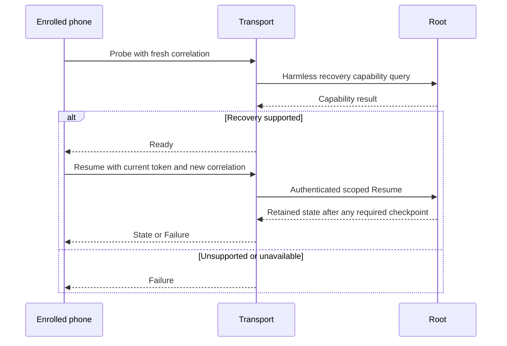

# Phone push registration recovery, draft schema 2

This contract adds an optional recovery exchange to [version 1 registration](phone-push-registration.md).
It defines codecs, shared fixtures and internal Root recovery.
Capability negotiation, transport wiring and Android ingress remain pending.
No installed component advertises this purpose yet.

## Negotiation and compatibility

Negotiate `remozio-push-registration/2` before transmitting a provider token.
Use the current enrolled TLS identity, scope, envelope and replay rules.
Complete a harmless Probe/Ready exchange before the phone sends Resume.
The host must check its optional Root recovery capability before returning Ready.
A transient capability error remains unavailable; it does not prove incompatibility.
Do not advertise approval or audit capabilities.
Keep the version 1 Offer, Prepared, Proof and Outcome bytes unchanged.
Proofs continue through the version 1 purpose.
An uncertain proof result requires Resume; it does not authorize automatic proof replay.
An older peer can reject optional recovery without closing ordinary approval connections.

The existing Root selector `phonePushRegistrationVersion` must continue returning 1.
Old clients require exact equality.
A separate optional recovery selector must establish schema 2 support before sensitive application data arrives.
The codec constant alone establishes no peer capability.

This diagram defines the required integration order. The transport handlers are not enabled by this PR.

## Frame

Use a deterministic CBOR map with exactly keys 0 through 4.
Key 0 is `dev.remozio.phone.push.registration`; key 1 is unsigned 2.
Key 2 selects the role; key 3 is a fresh 16-byte correlation ID; key 4 contains the typed body.
The limits remain 8192 bytes, depth 4 and 64 items.
Reject unknown fields, versions, roles, noncanonical bytes and trailing data.

| Role | Kind | Body |
| --- | --- | --- |
| Probe, phone to host | 6 | null |
| Ready, host to phone | 7 | Unsigned 2 |
| Resume, phone to host | 4 | Existing four-field token offer |
| State, host to phone | 5 | `[metadata, phase, observationAgeMilliseconds]` |
| Failure, host to phone | 3 | Unsigned 0 unavailable, 3 superseded, 4 expired or 5 incompatible |

Schema 2 does not accept the version 1 Offer, Prepared or Proof roles.
A failure cannot claim proof commitment or a confirmed mapping.
All responses must match the request correlation and authenticated enrollment.
Probe and its Ready or Failure response form one exchange.
Resume and its State or Failure response form the next exchange on that connection.
Use a fresh correlation for each exchange.
Ready carries no provider token, enrollment binding or possession proof.
It confirms the recovery contract only; it grants no approval or delivery authority.
The transport handles Probe and Ready. Root receives only the authenticated Resume operation.
An uncertain application exchange cannot trigger automatic route fallback or proof replay.

| Phase | Tag | Observation age |
| --- | --- | --- |
| Awaiting provider proof | 0 | null |
| Proof committed | 1 | null |
| Mapping observed | 2 | Unsigned 0 through 4999 |

Metadata retains its original fourteen fields and excludes the provider challenge.
The historical proof expiry does not expire a committed mapping.
Mapping observed describes a recent gateway observation.
It establishes neither provider delivery nor desktop presence or current connectivity.

## Required runtime semantics

Resume derives scope from the current authenticated enrollment and checks protected provider policy.
A matching current token digest returns retained metadata without minting another candidate.
Only an expired unconsumed candidate can renew for an authenticated resume.
A changed token follows the normal checkpointed preparation path.
No response exposes a provider challenge.

The Root publisher records fresh separately pinned gateway evidence for Mapping observed.
Cached observations bind the Root publication session, trust revision and exact candidate and activation operations.
The Root rejects observations after publisher lease expiry, retirement or changed desired state.
Observation age starts when Root sends the gateway query.
The query deadline also bounds the cache; reply receipt cannot restart that window.
A missing or stale observation returns Proof committed.
The phone must include exchange elapsed time when interpreting the age.
Anchor the validity bound to the local request start; do not restart it when the response arrives.
No clock synchronization is assumed.

Android joins metadata only with a provider-delivered matching candidate ID and enrollment tag.
Recheck provider generation, token revision and enrollment incarnation after every suspension.
Use a separate attempt handle to reject older replies within one provider generation.
No network suspension may hold either storage lock.
Keep tokens and challenges out of descriptions, logs, notifications, audit and work identifiers.

## Evidence limits

Shared controls cover canonical bytes, hostile roles, schema separation, redaction and bounded observation ages.
Root controls cover idempotent resume, checkpoint failure, lease/session retirement and fresh mapping observations.
The gateway publication fixture uses a real coordinator and journals with software keys and a synthetic provider.
These components do not expose a new network purpose or Root IPC selector.
Authenticated transport recovery, Android ingress and scheduling remain integration work.
[Recorded component results](../docs/experiments/evidence/2026-10-17-phone-push-recovery-components.json) bind the implementation and tests to source commit `cfdaae3`.
The local gate passed 2506 native core tests, with one explicit GUI experiment skipped.
The six required ATC tasks passed 723 test reports, assembly and lint.
The shared recovery fixtures contain eleven valid and thirty-four invalid frames.
Version 1 source and fixtures remain byte-identical to the base.
These results do not exercise an advertised recovery purpose or optional Root IPC.
Codec acceptance cannot authenticate a message or establish actual gateway mapping state.
Installed services, hardware keys, actual FCM delivery and physical Android behavior require separate evidence.
