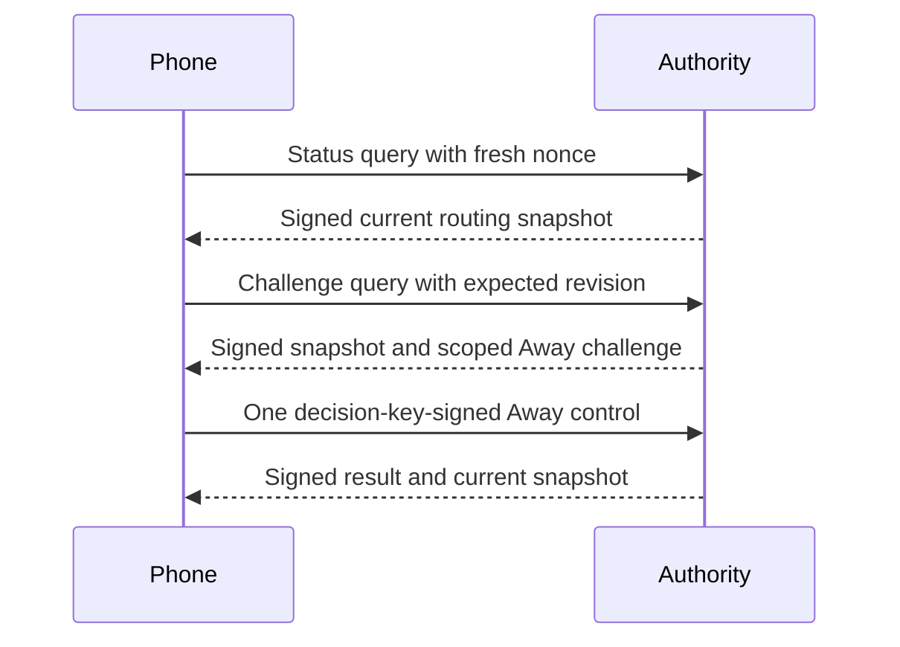

# Authenticated phone routing, version 1

The wire types support a fresh Mac/account status read and the existing Away-only control.
Automatic and Present remain Mac-only. Routing grants no approval, enrollment or credential authority.
This commit defines codecs and shared fixtures. Root, Transport and phone runtime composition remain incomplete.
Neither listener nor phone advertises this channel yet.

## Exchange

This diagram defines the intended exchange. The current codec tests do not prove that runtime path.
Use the existing enrolled TLS pins and scope on direct and relay connections.
The dedicated ALPN is `remozio-routing/1`. Its availability must mean the complete path exists.
An older peer remains incompatible with this feature while its existing approval protocol stays unchanged.

## Carrier

`PhoneRoutingFrame` uses a closed deterministic CBOR map with at most 4096 bytes, depth 3 and 20 items.

| Key | Value |
| --- | --- |
| 0 | Domain `dev.remozio.phone.routing` |
| 1 | Schema 1 |
| 2 | Frame kind |
| 3 | Fresh 32-byte query nonce |
| 4 | Kind-specific payload |

| Kind | Payload |
| --- | --- |
| 0, status query | Null |
| 1, challenge query | Expected routing revision, unsigned 64-bit |
| 2, apply Away | Array of existing canonical control bytes and its 64-byte decision signature |
| 3, authority response | Array of canonical response bytes and its 64-byte authority signature |
| 4, transport failure | Unsigned 0, unavailable; or 1, incompatible |

Apply accepts only the existing [Away control](routing-away.md), with a 1024-byte inner limit.
A response requires the same nonce inside its signed payload and outer carrier.
An unsigned failure can only mark work unavailable. It cannot establish a mode, conflict, challenge or successful change.

## Authority response

`RoutingStatusResponse` uses exactly keys 0 through 16, at most 3072 bytes, depth 2 and 40 items.

| Key | Field |
| --- | --- |
| 0 | Schema 1 |
| 1–4 | Mac, account, phone and enrollment epoch; 16 bytes each |
| 5 | Query nonce; 32 bytes |
| 6 | Outcome: 0 status, 1 challenge, 2 applied, 3 conflict |
| 7 | Root clock epoch; 16 bytes |
| 8 | Sample instant on that Root monotonic clock; unsigned milliseconds |
| 9 | Current mode: 0 Automatic, 1 Present, 2 Away |
| 10 | Current routing revision; unsigned 64-bit |
| 11 | Effective destination: 0 local Mac, 1 phones |
| 12 | Coarse presence reason |
| 13 | Detection limitation; unsigned 0 or 1 |
| 14 | Canonical Away challenge bytes, or null |
| 15 | SHA-256 digest of the submitted canonical control, or null |
| 16 | Historical applied revision, or null |

Reason tags are 0 manual Present, 1 manual Away, 2 remote desktop, 3 locked, 4 displays off,
5 displays dark, 6 idle, 7 active and 8 detector unavailable.
The codec rejects contradictory mode, destination and reason combinations.
Detector grace can retain either destination, with its limitation explicitly set.

A status has no challenge, digest or applied revision.
A challenge matches the complete response scope and current revision. An exhausted revision cannot issue another challenge.
An applied result has a control digest and a nonzero historical revision no greater than the current revision.
A conflict has no challenge or applied revision. Its digest is present only when it concerns a submitted control.
The runtime owner must check which outcome and digest its pending operation permits.

## Signature and freshness

Sign the deterministic map `{0: "dev.remozio.routing", 1: 1, 2: 2, 3: 2, 4: responseBytes}`.
Use the enrolled authority P-256 key and the existing SHA-256/raw 64-byte signature format.
This response type and purpose differ from the unchanged Away control type 1 and purpose 1.
Approval and gateway signatures do not verify as routing responses.

Parsing and signature verification do not establish current status by themselves.
The receiver must match the trusted authority key, live enrollment scope, outstanding nonce and expected operation.
It must reject late responses using its sleep-inclusive elapsed deadline.
A Mac monotonic instant cannot be compared directly with the phone clock.
Mark observations as last known after disconnection or freshness loss. Never queue an offline mode change.

## Current state versus receipt

A retained receipt can acknowledge Away at revision 3 while the Mac currently uses Present at revision 5.
Show the current Present state. The historical receipt does not authorize another Away write or prove Away remains selected.
The Root must read the current state under its serialized authority boundary when it signs the result.
Conflict recovery likewise returns the current state without silently overwriting it.
Do not automatically repeat a mutation after a lost acknowledgment.
Set Away still uses the enrolled decision key, with no extra biometric or confirmation.

## Evidence and remaining integration

Swift and Kotlin share 17 valid response vectors, 105 signed invalid response vectors,
23 valid carrier vectors and 20 invalid carrier vectors.
The tests cover purpose/key/domain separation, every signed field, strict shapes, unsigned limits, resource limits and mutable ownership.
They include a historical Away receipt with a current Present mode and an outer/inner nonce mismatch.

Thirteen selected Swift tests pass, including the six existing Away tests.
All 154 JVM protocol tests pass through ATC, including seven new routing tests.
The existing Away bytes and verification API remain unchanged.
These results do not prove a live Root/Transport exchange, phone freshness, revocation handling or Android UI behavior.
Those parts must be implemented before the feature is advertised.

The component results above were recorded on 21 October 2026.
The extracted codec, test and vector files match commit `e2ad0c235f99b281f424b13e0e62492d5a5e23d1`.
The current public local gate remains pending.
